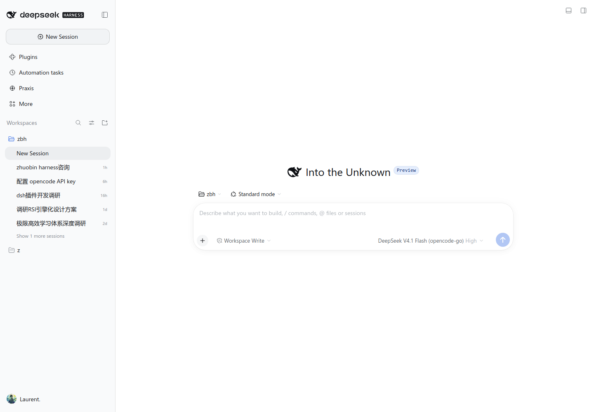
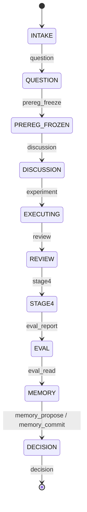

# Praxis

Praxis 是 DeepSeek Harness（DSH）的科研工作流引擎与观测台插件。它把一个研究问题从立项推进到可审计决策：记录问题 → 冻结可证伪的预注册 → 讨论 → 实验 → 复核 → 独立评估 → 记忆 → 决策。每个状态变化都有 receipt，每次图修改都有 revision。

- 插件包：`@local/dsh-praxis`（Host bundle + Observatory Client）
- 模型工具：`rsi_run`（22 个动作，含 `question`）
- 命令：`/praxis status | start <playbook> | gate | map`
- 主界面：`sidebar.panellist` → `main[praxis]`；输入框 dock 显示当前阶段与下一步动作
- 契约测试：`node --test test/praxis/*.test.js` → **140 pass / 0 fail**
- 浏览器验收：`node --test test/praxis/acceptance/*.test.js`（真实 Chrome + CDP，零 npm 依赖；含全生命周期到 DECISION）



## 1. 界面

Praxis v3 的界面只有三个区域：**运行条（60px）**、**泳道画布**、**按需滑出的检查器/抽屉**。

| 区域 | 规则 |
|---|---|
| 运行条 | 左：产品名 + Run 标题 + 阶段 chip + 版本；中：阶段进度 `n/10` + `运行 / 蓝图` 双模态；右：**全屏唯一主按钮** + 更多菜单 |
| 画布 | 三条语义泳道（定义问题 / 探索与执行 / 证据与决策），15 个节点在 1440×1000 下一屏可见，0 裁切 |
| 节点 | 三行：中文名 + 执行状态（等待/进行中/已完成/被阻断/需核对）+ 条件（缺失/已满足/继承待确认）。不显示内部码 |
| 检查器 | 选中节点或点主按钮后从右侧滑出（360px），显示双轴状态、阻塞原因、当前唯一动作表单 |
| 抽屉 | 源码 / 运行列表 / 认知地图 / 证据链 / 审计 / 超参数，480px 浮层，同一时刻只开一个 |
| Dock | 一个 chip：`预注册已冻结 · 提交讨论` 或 `预注册已冻结 · 阻塞 1` |

### 1.1 两个模态，不是两套真相

```text
运行（默认，只读）   ── 选节点、看状态、提交当前动作、看证据
蓝图（显式进入）     ── 拖节点、连线、删除非保护节点；保存前必须确认 diff
```

运行态**没有**连线端口、删除按钮、拖拽或 actor 选择器。拓扑修改只能进入蓝图态；保存请求带 `expectedRevision`，冲突返回 409 并保留草稿。离开蓝图且草稿未保存时弹出确认。

### 1.2 状态可视化

| 通道 | current | selected | done | blocked | failed | pending |
|---|---|---|---|---|---|---|
| 形状 | 左 3px 竖条 + 实心点 | 虚线外环 | 实心勾 | 斜纹 + 三角 | 双线边 + 叉 | 空心圈 |
| 颜色 | brand | label-secondary | success | warn | error | label-tertiary |

形状通道独立于颜色，灰度或色弱下仍可区分。

## 2. 领域模型

### 2.1 状态机（唯一来源：`src/graph.js` 的 `STATE_ORDER`）



非法转移返回 `INVALID_TRANSITION`，不改 state、不改 version，并写入 `transition.denied` 事件。

### 2.2 双轴节点状态

每个节点同时有两个独立事实：

- **execution**：`pending / active / done / blocked / failed`。只由状态游标与 receipt 决定。产物存在不等于走过此门。
- **condition**：`missing / satisfied / stale / unknown`。只由产物决定。`stale` 表示产物来自父 Run 或旧版本。

这样修复了上一版的经典倒挂：`INTAKE` 阶段不可能出现“下游门已完成”。

### 2.3 图不变量（审计）

| 码 | 不变量 |
|---|---|
| I1 | `done` 节点的所有前驱必须 `done` |
| I2 | 同一连通分量内 `active` 节点 ≤ 1 |
| I3 | gate `done` ⇒ condition ≠ `missing` |
| I4 | gate `done` ⇒ 被守护 stage ∈ {`active`, `done`} |
| I5 | 进度计数与节点状态一致 |
| I6 | `done` 节点的阶段索引 ≤ 当前状态索引 |

审计失败时 `view.graph.audit.ok = false`，界面显示“状态不一致，需要核对”，并停用推进动作。

### 2.4 fork 纯净性

`set_knobs` 派生新 Run 时：新 Run 回到 `INTAKE`，`preregHash` 清空，父契约作为草稿保留（`prereg.inheritedFrom` / `prereg.inheritedHash`），研究产物标记为继承。子 Run 必须重新冻结契约，`gate('experiment')` 才会打开。

旧数据在 `load` 时自动迁移（幂等）：`INTAKE + preregHash` 的脏记录会被对账，写入 `migration.reconciled` 事件。

## 3. 图模型

```js
Graph = { id, playbookId, revision, layoutVersion: 2, name, nodes[], edges[] }
Node  = { id, type: 'start'|'stage'|'gate'|'actor'|'end', label, stage?, config{action, gate, guards}, position{x,y}, protected? }
Edge  = { id, from, to, port: 'contract'|'artifact'|'evidence'|'veto' }
```

- **布局是图的一部分**：`layoutVersion: 2` 使用三条泳道，节点 156×64、列距 28、泳道间距 120。
- **保护节点**：`start`、`end`、以及所有 playbook 阶段/门节点不可删除（`PROTECTED_NODE` / `V10`）。
- **端口推导**：gate → `contract`，指向 gate → `evidence`，其余 → `artifact`（`derivePort`，`V11` 校验）。
- **revision**：每次保存递增；保存请求必须带 `expectedRevision`，否则 428，过期则 409。

## 4. API（`/praxis/api`）

| 方法 | 路径 | 说明 |
|---|---|---|
| GET | `/state` | `{...view, view, serverTime, revision}`；`wireVersion: 2`，含 `catalog` |
| GET | `/graph?runId=` | 扁平图投影：`{id, playbookId, revision, nodes, edges, states, current, progress, audit}` |
| POST | `/graph` | 保存蓝图；body 需 `expectedRevision`；成功返回新 revision |
| POST | `/layout` | 只更新节点坐标 |
| GET | `/evidence` | 运行、事件、receipt、图审计 |
| POST | `/command` | `{command:{commandId, action, runId?, expectedDomainVersion?, payload?}}` |

命令结果：成功 200 `{receipt, view}`；版本冲突 409 `CONFLICT`（带当前 view）；其它拒绝 422（带 `receipt / nextAction / blockers / view`）。同一 `commandId` 重放返回 `replayed`，不重复副作用。

`catalog` 是 UI 文案的唯一来源：状态、动作、节点执行/条件、原因码、阻塞码、事件名全部由 Host 下发中文标签。

## 5. 测试与证据

| 层 | 命令 | 覆盖 |
|---|---|---|
| 契约测试 | `node --test test/praxis/*.test.js` | 领域状态机、图模型与不变量、fork/迁移、wire 契约、store、HTTP、模块构建 |
| 浏览器验收 | `node --test test/praxis/acceptance/*.test.js` | 真实 Chrome：可见节点比例、内容占比、唯一主按钮、内部码为 0、破坏性控件为 0、横向溢出为 0；全生命周期 start→…→DECISION 含角色委托审计 |
| 证据采集 | `node tools/evidence/capture.mjs` | 截图 + `docs/praxis/evidence/manifest.json`（sha256、构建 hash、端口、视口、主题、场景、时间） |

浏览器测试使用独立 profile 与独立 `statePath`（`/tmp/praxis-acceptance/`），不写用户的 `~/.dsh/praxis/state.json`。

### 5.1 客户端构建

`client.js` 是生成文件，来源是 `plugins/dsh-praxis/client/*.js`：

```bash
node plugins/dsh-praxis/build-client.mjs          # 生成 client.js
node plugins/dsh-praxis/build-client.mjs --check  # 校验是否最新（测试会跑）
```

## 6. 已验证行为

| 场景 | 结果 |
|---|---|
| 冷启动：空态 → 新建运行 → 填写研究问题 → 提交 | INTAKE → QUESTION，进度 1/10 → 2/10，banner 回报 |
| 完整研究闭环：立项→问题→预注册→人格→讨论→实验→复核→阶段四→独立评估→读评估→记忆提议/提交→决策 | 13 步全部 committed，终态 DECISION，`actor.delegated` 审计 2 条 |
| 独立评估角色委托（UI） | 未勾选“以独立评估者身份提交”时按钮禁用；勾选后提交成功，记录 `actor.delegated` |
| 认知地图登记（UI） | 地图抽屉登记主张后 `claims=1`，状态配色与证据计数正确 |
| 运行推进：冻结预注册 → 提交讨论 | PREREG_FROZEN → DISCUSSION，v3 → v4 |
| 门状态真值 | `INTAKE` 下游门显示“等待/缺失”，不再出现 DONE 倒挂 |
| fork | 子 Run 回到 INTAKE、`preregHash=null`、`gate('experiment').allow=false` |
| 旧数据迁移 | v1 布局与脏 fork 记录自动对账，幂等 |
| 图保存冲突 | 过期 `expectedRevision` → 409 + 当前图 |
| 蓝图层保护 | 删除 `start/end/stage/gate` → `PROTECTED_NODE` |
| 亮/暗主题 | 两套主题下节点、泳道、检查器、抽屉均正常 |
| 窄屏 1024 | 无页面横向溢出；`world scale=0.762` 时显示“视口不足，可拖拽查看” |

未验证项写入 `docs/praxis/verification.md`，不在此处冒充通过。

## 7. 安装

```bash
# 在 DSH 中（需要 danger-full-access 或审批）
plugin_manager action=install_bundle target=/绝对路径/plugins/dsh-praxis
```

安装后需要新会话或重启，Host 工具才会出现。详细验证流程见 `docs/praxis/verification.md`。

## 8. 已知限制

- 1024 全应用（宿主侧栏展开）时画布 744×840、world scale 0.762，节点正文字号低于设计下限；折叠宿主侧栏或使用插件根 1024 宽时达标。这是宿主布局约束，已记录为不可判定项。
- 认知地图目前只读展示 claim/edge/frontier/blindSpot；在图上直接编辑主张走 `map_claim` / `map_edge` 命令。
- 运行中修改 Playbook 会生成新 revision；现有 Run 固定原 revision，不自动迁移（迁移需要显式方案与批准）。
