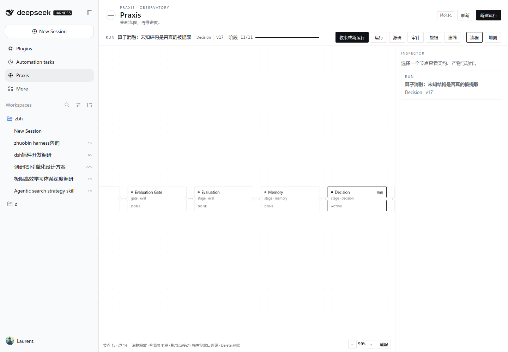
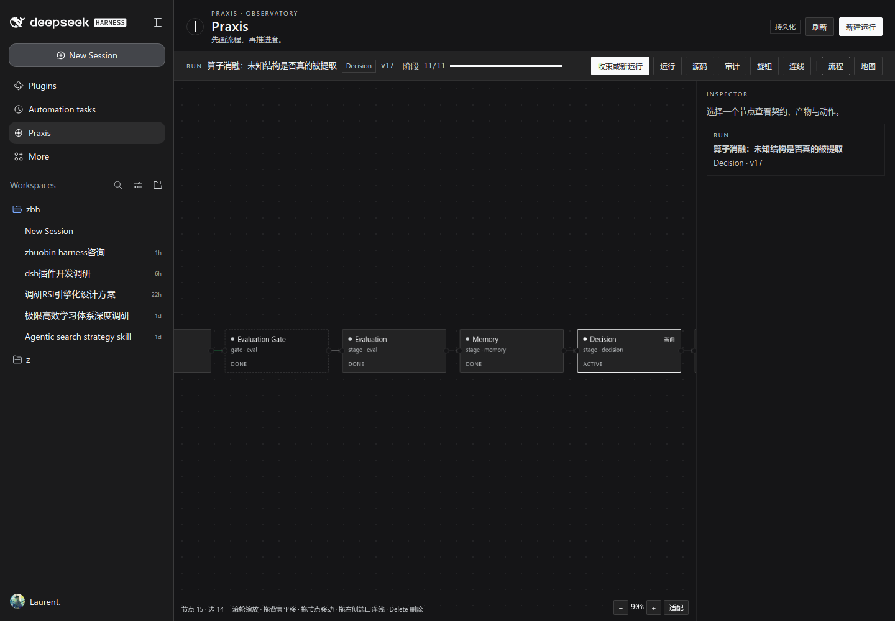

# Praxis

Praxis 是一个 DeepSeek Harness（DSH）的科研判断引擎插件。v2 起，它的主界面是**流程画布**，不是仪表盘：Playbook 就是一张可编辑的图，运行状态叠加在图上，用户只需要看“当前节点、阻塞、下一动作”。

- 插件包：`@local/dsh-praxis`（Host bundle + Observatory Client）
- 工具：`rsi_run`（20 个动作）
- 命令：`/praxis status | start <playbook> | gate | map`
- 主界面：`sidebar.panellist` → `main[praxis]`；输入框 dock 只显示一个动作 chip
- 测试：`node --test test/praxis/*.test.js` → **99 pass / 0 fail / 0 skip**



## 画布（v2）

| 能力 | 实现 |
|---|---|
| 节点 | `start / stage / gate / actor / end`，默认 15 节点 14 边，左到右单链 |
| 状态 | `pending / active / blocked / done / failed`，只高亮当前与已走路径 |
| 编辑 | 拖节点（自动 `layout_save`）、滚轮缩放、拖背景平移、连线模式（点起点→点终点） |
| 检查器 | 右侧 320px：动作、契约表单、CONNECT、技术细节（哈希/版本折叠） |
| 运行条 | 单行：Run 名、阶段 n/11、阻塞、下一动作、运行/源码/审计/旋钮/连线/流程/地图 |
| 源码 | JSON 抽屉，与画布同一 schema；校验失败返回 V1–V9 |
| Run 列表 | 抽屉；新建后自动激活 |
| 认知地图 | 第二画布：claim 节点、边、空态提示 |
| Dock | 仅一个 chip（`Praxis · 3 阻塞` 或 `Praxis · 冻结契约`），无标题复述 |



## 图模型与 API

```text
Graph = { id, playbookId, version, name, nodes[], edges[], contentHash }
Node  = { id, type, label, stage?, config{action,gate,guards}, position{x,y} }
Edge  = { id, from, to, port: contract|artifact|evidence|veto }
```

| 方法 | 路径 | 行为 |
|---|---|---|
| GET | `/praxis/api/state` | 运行、图、状态叠加、knobs、playbooks |
| GET | `/praxis/api/graph?runId=` | `{graph, states, current, runId, version}` |
| POST | `/praxis/api/graph` | 校验并保存图；非法 400 + `INVALID_GRAPH` + V 码 |
| POST | `/praxis/api/layout` | 只合并节点坐标 |
| POST | `/praxis/api/command` | 引擎命令（含 `graph_save` / `layout_save` / `activate`） |

## 设计要点（引擎未变）

| 机制 | 实现 |
|---|---|
| 冻结契约 | `prereg_freeze` 后哈希固定；结果后修改返回 `PREREG_VIOLATION` + `new-run` |
| 真实数据边界 | playbook `requiredPrereg` / `input` 契约；模拟替代真实数据被 gate 拒绝 |
| 独立评价 | `eval_report` 仅 evaluator；`eval_read` 显式；无 receipt 的 promote 返回 `EVAL_NOT_READ` |
| 不可自改内核 | evaluator/stop/permissions/hidden-tests/audit/memory-commit/resolver/budget/kill-switch |
| 认知地图 | `map_claim` / `map_edge`；矛盾不平均；未知可登记 |
| 独立人格 | `pin_persona` 要求 `topicBinding` 三字段 + `sinthome.observableWorkProduct` |
| 野心值 | `A_p/E/A_d/A_final` + inflation 检测 |
| 反均值回归 | 同结论上限 → `DRIFT_DETECTED`；`meanReversion` 读数 |
| 超参冻结 | 运行中改旋钮 fork 新 Run；`layout_save` 不触发 fork |
| 持久化 | `~/.dsh/praxis/state.json`（tmp+rename）；重启恢复 runs/knobs/graphs |

## 安装

```text
plugin_manager install_bundle target=/absolute/path/to/plugins/dsh-praxis
# 安装后重启 dsh web，让新 Host/Client 代际生效
```

安装后：`Config.listConfigs` 的 `include:praxis` active；`Slots.listSubTree` 的 `sidebar.panellist` occupant `praxis`；打开侧栏 **Praxis**。

## 验证

```bash
node --test test/praxis/*.test.js     # 99 tests
```

测试分布：engine 39、graph 21、graph-api 8、store 6、host 10、http 14、integration 1。

已验证交互（1440×1000，独立临时 Chrome profile）：

- 拖拽 Intake 后 `state.json` 记录 `{x:350,y:287}`，重启保留；
- 连线模式 Start→Question，边数 14→16，服务端校验通过；
- 源码抽屉保存图后 `graph.version` 递增；
- 新建 Run 后运行条与画布切换到新 Run；
- 亮/暗主题、1024 窄屏、1080 暗色画布均截图；
- 拖拽/缩放/选择节点无控制台异常。

未验证：调色板拖入、路径回放模式、Dock chip 点击跳转（需要 Host 导航 API）、真实 subagent 派工。

## 布局

```text
plugins/dsh-praxis/   Host（index.js / src/* / client.js / locale / icon）
test/praxis/          契约测试（含图模型与画布 API）
docs/praxis/          契约、验收证据、再设计简报、原型、实现笔记
```

## 许可

MIT
