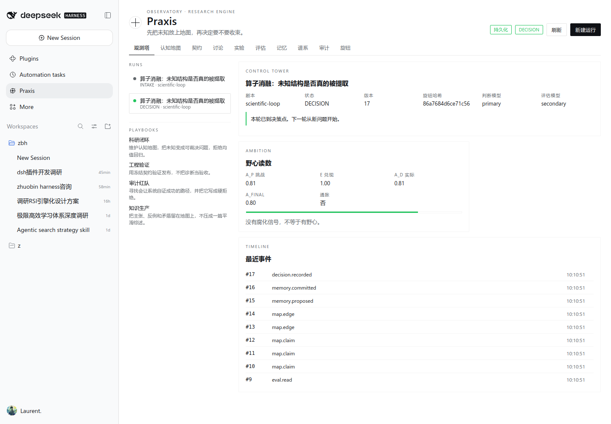

# Praxis

Praxis 是一个 DeepSeek Harness（DSH）的科研判断引擎插件。它把"判断—执行—评价"三权分离做成 Host 内的硬约束，并把**认知地图**、**独立人格**、**野心读数**和**反均值回归**做成可审计对象，而不是提示词修辞。

- 插件包：`@local/dsh-praxis`（Host bundle + Observatory Client 面板）
- 工具：`rsi_run`（模型调用）
- 命令：`/praxis status | start <playbook> | gate | map`
- 面板：侧栏 Praxis · 主面板 10 个视图 · 输入框 dock · 持久化状态
- 测试：`node --test test/praxis/*.test.js`（70 条，0 fail 0 skip）



## 设计要点

| 机制 | 实现 |
|---|---|
| 冻结契约 | `prereg_freeze` 后契约哈希固定；结果后修改返回 `PREREG_VIOLATION` + `nextAction:new-run` |
| 真实数据边界 | playbook 的 `requiredPrereg`/`input` 契约；模拟数据替代真实数据会被 gate 拒绝 |
| 独立评价 | `eval_report` 只允许 evaluator actor；`eval_read` 是显式动作；没有 receipt 的 promote 返回 `EVAL_NOT_READ` |
| 不可自改内核 | evaluator / stop / permissions / hidden tests / audit / memory-commit / resolver / budget / kill-switch 路径触碰即 `FORBIDDEN_BOUNDARY_EDIT` |
| 认知地图 | `map_claim` / `map_edge` / `frontier` / `meanReversion`；矛盾不平均；未知可登记 |
| 独立人格 | `pin_persona` 要求 `topicBinding` 三字段 + `sinthome.observableWorkProduct`，缺一即 `PERSONA_DECORATIVE` |
| 异质度 | `scoreHeterogeneity` 输出 `D/styleOnly/gain/minorityRetention`；低于地板记 `CORRUPTION_WARNING` |
| 野心值 | `A_p/E/A_d/A_final` + inflation 检测；自报与独立分差 >0.25 记 `ambition.inflation` |
| 反均值回归 | `meanReversion` 读数 + 决策层同结论上限（`DRIFT_DETECTED`） |
| 超参冻结 | 运行中改旋钮 fork 新 Run（`parentId` + lineage），不改写当前 Run |
| 持久化 | 状态写 `~/.dsh/praxis/state.json`，原子写；重启后 runs/knobs 恢复 |

## 安装与启用

```bash
# 1) 以本地目录安装 bundle（DSH 会把目录 link 进 profile）
#    plugin_manager install_bundle target=/absolute/path/to/plugins/dsh-praxis
# 2) 启用（安装时会自动 enable）
# 3) 重启 dsh web 让新的 Host 模块代际生效
```

安装后：

- `Config.listConfigs` 中 `include:praxis` 处于 active；
- `Slots.listSubTree` 的 `sidebar.panellist` 出现 occupant `praxis`；
- 打开侧栏 **Praxis** 即进入 Observatory。

> 当前环境已验证：bundle `enabled:true`、row `praxis`、`/praxis/api/state` 返回 200、侧栏与主面板渲染、10 个页面截图。3080 实例需要在安装后重启一次 `dsh web` 才会加载新 Host 代际。

## 页面

| 页面 | 内容 |
|---|---|
| 观测塔 | 状态、版本、旋钮哈希、门禁、野心读数、事件时间线 |
| 认知地图 | 节点/边/矛盾/frontier/均值回归 + 登记主张与连边 |
| 契约 | 预注册表单、冻结哈希、冻结后只读提示 |
| 讨论 | 观点包、异质度 D、人格绑定 |
| 实验 | 派工、产物哈希、复核、阶段四 |
| 评估 | 评估报告、`eval.read`、promotion 硬门 |
| 记忆 | 提案与用户提交分离 |
| 谱系 | Run 父子关系与 fork 子代 |
| 审计 | 全事件表与 JSON 导出 |
| 旋钮 | 10 个超参滑杆，改即 fork |

## 剧本（Playbook）

内置四个声明式入口：`scientific-loop`（科研闭环）、`engineering-release`（工程验证）、`audit-redteam`（审计红队）、`knowledge-production`（知识生产）。Q19/BENGI 不是产品中心，只是 `scientific-loop` 的一个历史输入实例。

## 开发

```bash
node --test test/praxis/*.test.js     # 70 tests
node --check plugins/dsh-praxis/index.js plugins/dsh-praxis/client.js
```

- `test/praxis/engine.test.js`：状态机、10 条硬规则、评分、地图、dump/load、权限矩阵
- `test/praxis/store.test.js`：file/domain/memory 三模式、重载、幂等
- `test/praxis/host.test.js`：actor 权限、只读动作、幂等
- `test/praxis/http.test.js`：loopback 同源、200/403/400/409、state 信封
- `test/praxis/integration.test.js`：start→freeze→discussion→experiment→review→stage4→eval→memory→decision

## 布局

```text
plugins/dsh-praxis/   Host bundle（index.js / src/* / client.js / locale / icon）
test/praxis/          TDD 契约测试
docs/praxis/          契约、编队计划、侦察、审计、截图
```

## 许可

MIT
