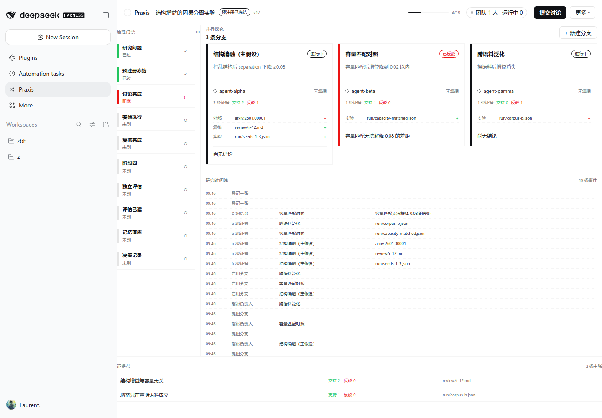
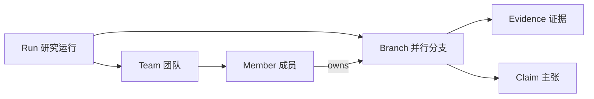
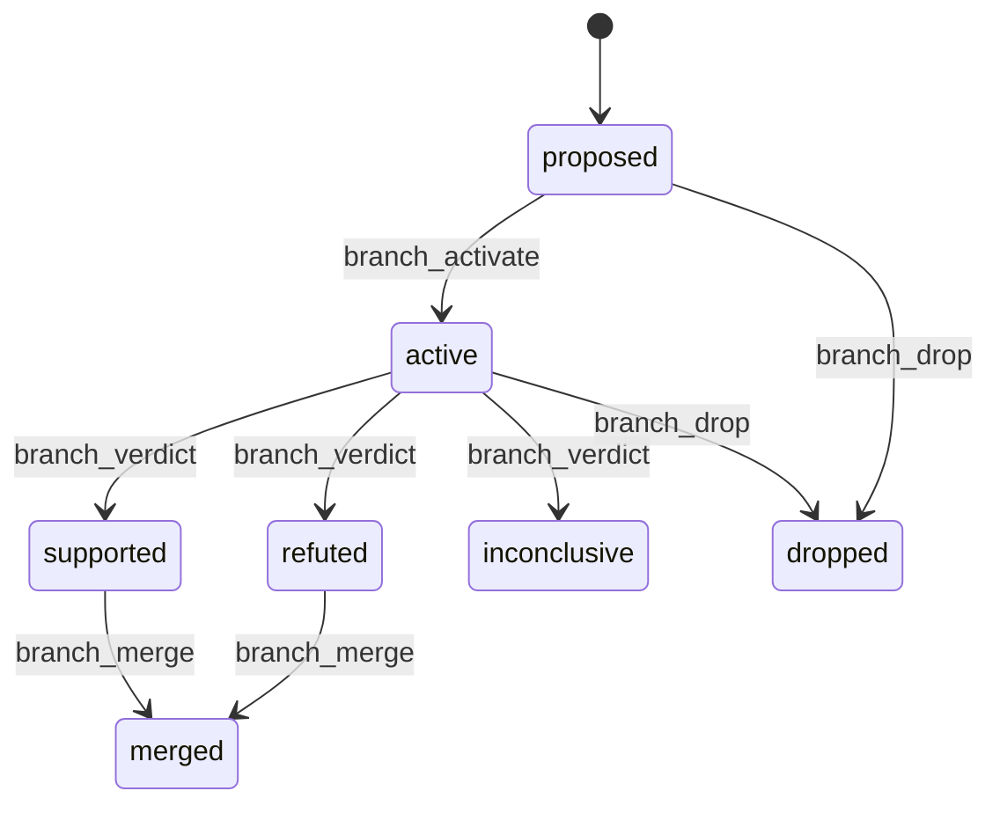

# Praxis

Praxis 是 DeepSeek Harness（DSH）的 RSI 研究驾驶舱：把一次研究运行呈现成**并行探究分支 + 真实 agent 团队 + 治理门禁 + 证据带**。它不画流程图，它管研究。

- 插件包：`@local/dsh-praxis`（Host bundle + Client 驾驶舱）
- 模型工具：`rsi_run`（29 个动作，含 7 个分支动作）
- 命令：`/praxis status | start <playbook> | gate | map`
- 主界面：`sidebar.panellist` → `main[praxis]`；输入框上方 dock 显示运行状态
- 契约测试：`node --test test/praxis/*.test.js` → **162 pass / 0 fail**
- 浏览器验收：`node --test test/praxis/acceptance/cockpit.test.js`（真实 Chrome + CDP，零依赖）



## 1. 产品对象



| 对象 | 说明 | 真相源 |
|---|---|---|
| Run | 一次研究：预注册、阶段、决策 | Host 事件账本 |
| Branch | 一条并行探究线：可证伪陈述、负责人、证据、结论 | `run.branches[]` + branch 事件 |
| Team | 参与本 Run 的 agent：Lead、teammates、subagents | 实时读 DSH `agentTeams` / `agents` |
| Evidence | 分支上的证据：实验、外部来源、复核、评估 | `branch.evidence` 事件 |

**关键区别**：同一 Run 允许多条 active 分支。研究不是单轨推进，界面因此按列并排展示分支，而不是画一条链。

## 2. 界面

```
┌──────────────────────────────────────────────────────────────────┐
│ 运行条：Run 名 · 阶段 n/10 · 团队 N 人 · 运行中 M · 唯一主动作      │
├───────────┬──────────────────────────────────────┬───────────────┤
│ 门禁轨    │ 并行分支板（每分支一列）              │ 检查器 360px  │
│ 200px     │ 状态 · 可证伪陈述 · 负责人 · 证据日志  │ 详情 + 动作   │
│ 10 项     ├──────────────────────────────────────┤               │
│           │ 研究时间线（真实事件流，按分支可点）   │               │
├───────────┴──────────────────────────────────────┴───────────────┤
│ 证据带：主张 · 支持/反驳计数 · 最新证据                            │
└──────────────────────────────────────────────────────────────────┘
```

| 区域 | 内容 |
|---|---|
| 运行条 | Run 名、阶段 chip、`n/10` 进度、团队人数与运行中人数（点击开团队抽屉）、唯一主按钮 |
| 门禁轨 | 10 道治理门：已过 / 阻塞（红条 + 缺失项数）/ 未到 |
| 分支板 | 每分支一列：状态色条、标题、可证伪陈述、负责人与状态点、支持/反驳计数、逐条证据日志、结论 |
| 时间线 | 运行事件流（提出分支、指派、启用、记录证据、给出结论、合流、登记主张…），点击分支名跳转 |
| 证据带 | 每条主张：支持数、反驳数、最新证据来源；矛盾并列不平均 |
| 检查器 | 分支 / 成员 / 证据 / 运行下一步，各带唯一动作与就地校验 |

运行态没有连线端口、节点拖拽、拓扑删除。分支是数据对象，不是画布图形。

## 3. 团队是真实的

Host 侧 `src/team.js` 直接读运行时：

| 来源 | 用途 |
|---|---|
| `ctx.agents.roots()` | 找当前 root Agent |
| `ctx.agentTeams.tryMembership/listMembers/listTasks` | Lead、teammates、任务板 |
| `ctx.subagents.listDescendants` | subagent 树（按需） |

```js
view.team = {
  source: 'live' | 'none',
  lead: { id, name, status } | null,
  members: [{ id, name, kind, status, model, currentTask, branchIds }],
  tasks: [],
  counts: { running, idle, tasksOpen, tasksDone },
}
```

规则：`source === 'none'` 时 `members` 必须为空，界面显示“尚未组建团队”。界面不伪造成员。实测在真实 DSH 会话内 `source='live'`，运行条显示“团队 1 人 · 运行中 0”。

## 4. 分支模型



| 码 | 不变量 |
|---|---|
| B1 | 分支必须有可证伪陈述（≥8 字符）才能给结论 |
| B2 | 允许多条 active 分支；active 必须有负责人 |
| B3 | 合流必须记录 `mergedInto` |
| B4 | 证据必须带 `kind`（experiment/external/review/eval）与 `ref` |
| B5 | 换负责人必须留 `branch.assigned` 事件 |

动作：`branch_propose` `branch_assign` `branch_activate` `branch_evidence` `branch_verdict` `branch_merge` `branch_drop`。PREREG_FROZEN 之前只能 propose。evaluator 只能记录 `kind='eval'` 的证据。

## 5. 治理门禁

| 区间 | 门 |
|---|---|
| 立项 → 研究问题 → 预注册冻结 | 无冻结预注册不能进执行 |
| 讨论 → 实验 → 复核 → 阶段四 | 缺结果或复核不能进阶段四 |
| 独立评估 → 评估已读 → 记忆 → 决策 | 无独立评估与读取回执不能决策 |

非法转移返回 `INVALID_TRANSITION`，不改 state、不改 version，写 `transition.denied`。角色隔离：`eval_report` 需 evaluator，`memory_propose` 需 root；界面用显式委托复选框提交，写 `actor.delegated` 审计事件。

## 6. API（`/praxis/api`，wire v4）

| 方法 | 路径 | 说明 |
|---|---|---|
| GET | `/state` | `wireVersion: 3`，含 `active`、`branches`、`team`、`gates`、`evidenceRows`、`catalog` |
| GET | `/graph` | 图与审计（保留，供门禁与不变量检查） |
| POST | `/command` | 200 成功 / 409 CONFLICT / 422 拒绝 / 428 缺 revision |
| GET | `/evidence` | 运行、事件、receipt、图审计 |

`view.catalog` 是 UI 文案唯一来源（阶段、动作、阻塞、原因、事件名）。

## 7. 验证

| 层 | 命令 | 覆盖 |
|---|---|---|
| 契约 | `node --test test/praxis/*.test.js` | 162 条：状态机、分支、团队投影、wire v4、图不变量、构建一致性 |
| 浏览器 | `node --test test/praxis/acceptance/cockpit.test.js` | 真实 Chrome：并行分支同屏 ≥2、门禁 10 行、证据带、primary=1、无横向溢出、无拓扑控件 |
| 证据 | `node tools/evidence/capture.mjs --v4 --manage-server` | 10 张截图（light/dark × empty/running 1440/1024/inspector/team）+ `docs/praxis/evidence/manifest-v4.json` |

## 8. 构建

```bash
node plugins/dsh-praxis/build-client.mjs          # 生成 client.js
node plugins/dsh-praxis/build-client.mjs --check  # 校验是否最新（CI 会跑）
```

`client.js` 是生成文件，来源 `plugins/dsh-praxis/client/*.js`（00 原语 / 10 store / 20 布局 / 30 驾驶舱 / 40 检查器 / 50 抽屉 / 60 shell / 70 样式）。改源码后必须重建；DSH 需重启才会重新加载 Client bundle。

## 9. 安装

```bash
plugin_manager action=install_bundle target=/绝对路径/plugins/dsh-praxis
```

安装后需新会话或重启，Host 工具才会出现。

## 10. 已知限制

- 团队投影依赖运行时存在 Agent Teams 会话；无会话时诚实显示 `none`。
- 分支负责人未被当前 team 收录时显示“未连接”。
- 1024 全应用（宿主侧栏展开）下分支列变窄；插件根 1024 宽正常。
- 运行中修改 Playbook 不自动迁移已有 Run。
