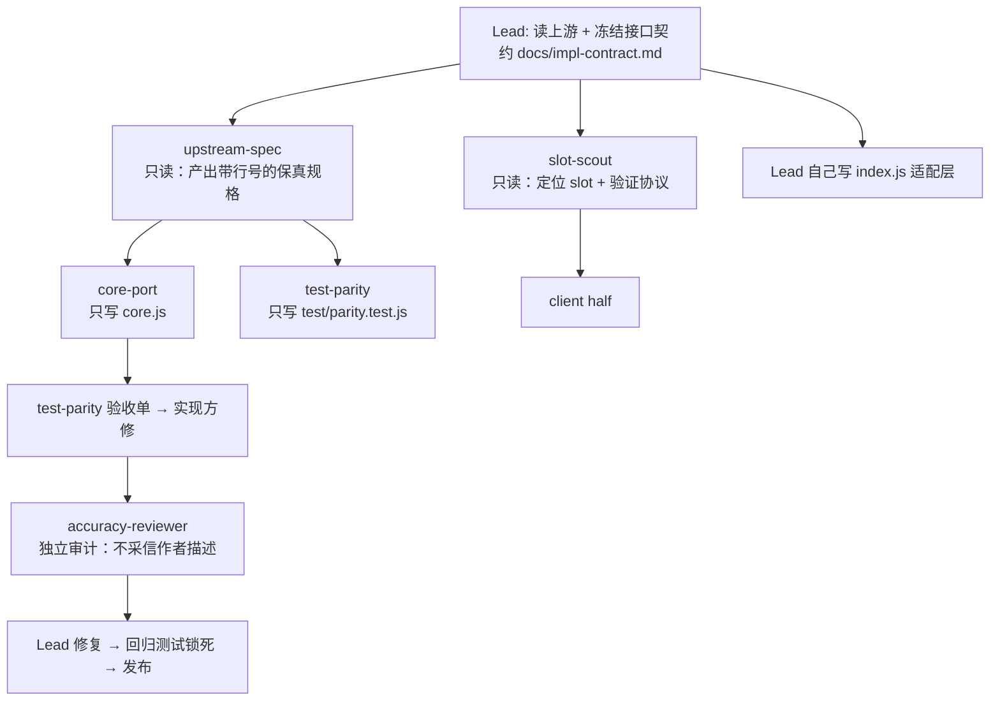
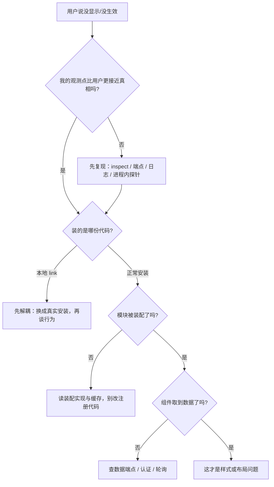

# DSH 插件开发经验教训

> 来源：`dsh-context-diet` 项目（2026-11-02 17:18 首提交 → 2026-11-03 08:57 发布 v0.2.2）。
> 目的：给后续所有 DSH 插件开发提供可执行的规则，而不是励志总结。
> 读者：接手插件任务的 Agent，以及做代码审查的人。

## 0. 一句话结论

这个项目的大部分返工不是因为不会写代码，而是因为**用错误的证据宣布完成**。
具体有三类：把上游文档当成行为、把安装成功当成生效、把"我改了"当成"它显示了"。

---

## 1. 五条硬规则（先看这个）

| # | 规则 | 反例（本项目实际发生） |
|---|---|---|
| R1 | **行为以源码为准，不以记忆或文档为准。** 移植类任务先写出带行号的行为规格，再写实现。 | 我"以为"移植了 pi-context-diet，实际 core.js 前 882 行是忠实实现，`index.js` 却走另一套自创契约。 |
| R2 | **每个判定必须有一条会变红的测试锁住。** | 冷判定方向反了（无时间戳=立即裁剪），因为没有测试覆盖"无时间戳"这一支。 |
| R3 | **"装好了"不等于"生效了"。** 生效需要独立观测点（端点、slot occupant、日志、文件）。 | 4 次连续认为界面已显示，用户 4 次说没有。 |
| R4 | **平台能力先探测，再设计。** 10 行探针脚本胜过 300 行实现。 | `assistant/message` 的 surface 替换被平台两条互斥规则拒绝，我先实现了一整条参数裁剪路径才发现。 |
| R5 | **失败一次就换证据来源，不要在原假设上重复改代码。** | 界面失败 4 次，前 3 次我都改了代码，第 4 次才去读装配实现。 |

---

## 2. 历史错误清单

时间线（Asia/Shanghai）：

```mermaid
timeline
    title dsh-context-diet 实际轨迹
    11-02 17:18 : 首提交（可运行版本）
    11-02 18:39 : 第 1 次做配置界面
    11-02 22:03 : 第 2 次（换 slot）
    11-02 22:49 : 第 3 次（补 volatile）
    11-02 23:38 : 第 4 次（改 configEditor 端点）
    11-03 00:18 : 用户要求删除界面
    11-03 00:37 : 目录重构 + 公开首提交
    11-03 01:44 : 重写为忠实移植 + footer（0.2.0）
    11-03 02:24 : 审计修复完成（0.2.1）
    11-03 08:57 : 定位装配缓存（0.2.2）
```

### 2.1 语义类错误（最贵，因为看不出来）

| ID | 现象 | 根因 | 现在锁住它的测试 |
|---|---|---|---|
| E1 | "已完成移植" | 两套并行策略：忠实核心是死代码，适配层走另一套契约 | `test/unit/core.test.js` 只允许 40 个冻结导出；`test/parity.test.js` 105 条带上游行号 |
| E2 | 插件带 compact 功能 | 概念错位：本插件是"动态裁剪提升专注度"，compact 是另一件事 | 测试断言 `parseCommand('compact')` 为 invalid、`statusLine` 输出不含 `/compact\|warming/i` |
| E3 | 第一步就裁剪 | 冷判定反向：`lastRequestTime===0` 被当作"无限空闲" | cold gate 四态测试（< TTL、== TTL、+1ms、无时间戳） |
| E4 | 三套 stub 文本并存 | 每次重写各自发明模板 | parity 逐字断言上游模板（仅品牌前缀不同） |
| E5 | 统计少报、重启后全丢、校准失真 | 适配层观测点缺失：只看"本次落盘"，且只读 `ownEvents()` | 两次请求累计口径、重启 hydrate、fork 继承、整请求校准 |
| E6 | 写/改参数裁剪永远不生效 | 平台不支持；我先写了实现，后验证 | 断言适配器不尝试、日志零追加、`args on` 返回明确错误 |

### 2.2 可视化类错误（最伤信任，因为用户能直接看到）

| 次 | 我做的改动 | 真实问题 | 代价 |
|---|---|---|---|
| 1 | 把配置页注册到 `plugins.item` | 那是插件卡片列表，不是设置区 | 用户发截图：设置区没有 |
| 2 | 改到 `settings.section`，但依赖 `configForms.whileServed` | 命名空间只在 Config 有 `.volatile()` 字段时才被 serve | 仍然不显示 |
| 3 | 给 9 个字段加 `.volatile()` | 方向对了，但仍受镜像时序影响 | 仍然不显示 |
| 4 | 改参考插件模式（Host 端点 + configEditor） | 代码是对的，但用户说"不要做界面了" | 5 小时返工 |
| 5 | footer 装好后仍不显示 | `dsh-client-modules` 缓存了"这个包没有 client half"的负判定，直到进程重启 | 又一轮误判 |

**这 5 次的共同结构**：我每次都改了"我认为错的那一层"，但从没建立"目标是否可见"的观测。真正有效的一步是第 5 次之后：

```text
读 dsh-client-modules 源码 → 发现 pkgMeta 缓存 (baseUrl, loaderName) → null
在进程内打印 pkgMeta / graph.entries / clientPath → 拿到硬证据
清掉该条缓存并 flush → graph 出现本包 → slot occupant 出现
```

### 2.3 环境类错误（低成本，但会吃掉时间）

| 现象 | 正确做法 |
|---|---|
| `node --test <目录>` 报 `Cannot find module` | 传具体文件：`node --test test/*.test.js test/unit/*.test.js` |
| `npm pack` 报 `EROFS` | 指定可写缓存：`NPM_CONFIG_CACHE=/可写目录 npm pack` |
| `install_bundle` 返回 `already-installed` | 先 `remove_bundle`，再 `install_bundle` |
| `install_bundle` 报 `a registry must be an http(s) URL: ` | 必须显式传 `registry: "https://registry.npmjs.org/"` |
| pnpm 装 git 依赖走 HTTPS，而本机只有 SSH 通 | 只对该仓库做 `git config --global url."git@github.com:OWNER/REPO.git".insteadOf "https://github.com/OWNER/REPO.git"` |
| 装好了但 Host 侧不激活 | 先看 `Config.listConfigs` 的 `status`；`inactive` 时读诊断里的 import 错误路径，进程内缓存要重启才清 |

### 2.4 文档与协作错误

| 现象 | 后果 | 规则 |
|---|---|---|
| README 先写成"已完成" | 读者按 README 验证会失败 | 文档只写**已验证**的内容；未验证项单列一节 |
| 声称"已截图确认" | 用户当场发现没有 | 不能声称未做的事；无浏览器控制时明确写"未验证" |
| 用根目录做工作区 | 用户要开发别的东西时被污染 | 一个项目一个目录；临时资料进 `.internal/` 且 gitignore |

---

## 3. 工作方式反思：串联盲调 vs 系统排查 + 多代理并发

### 3.1 前期：主 Agent 串联式调试

做法：改一点 → 重装 → 看用户截图 → 再改 → 再重装。
特征：

- **串行**：一次只验证一个假设，且每个假设都要改动代码。
- **无证据**：没有日志、没有源码行号、没有返回值，只有"用户说没有"。
- **假设不变**：一直假设"slot 注册位置不对"，从没假设"装配链路根本没跑"。
- **单线程上下文**：所有读取、推理、修改、验证都在一个上下文里，越到后面越不敢推翻前面的结论。

代价（实测）：

| 指标 | 串联期（17:18–23:38，约 6 小时） | 并发期（01:44–02:24，约 40 分钟） |
|---|---|---|
| 有效缺陷修复 | 2（可运行版本、开启默认） | 6 个 P1/P2（统计、恢复、校准、展示、fork、bracket） |
| 返工次数 | 界面 4 次重写 | 0 次（契约冻结后未改接口） |
| 结论可复现性 | 无（只有截图对话） | 有（105 条 parity + 187 条测试 + 行号） |
| 用户参与次数 | 5 次（每次都要发截图/催） | 0 次（全程自主） |

### 3.2 后期：先建证据基座，再多代理并发

实际结构：



真正起作用的 5 个机制：

1. **契约先行**：把导出面、命名、端点 JSON、测试契约写成一份文件，所有人照它写。接口没冻结前不开工写代码。
2. **只读侦察并行**：规格与插槽定位互不依赖，可同时进行；两者都产出"带行号/带证据"的文档。
3. **写作用域分离**：一人一个文件（`core.js` / `test/` / `client.js` / `index.js`），避免覆盖。
4. **测试反向驱动**：测试作者把"上游断言"搬过来，用失败清单当验收单交给实现方。
5. **独立审计**：审计方自己写对抗脚本，且被要求"不采信描述，只信代码与运行结果"。首轮就查出 3 个 P1。

### 3.3 多代理的失败教训（同样重要）

| 问题 | 实际发生 | 教训 |
|---|---|---|
| 成员上限 | 想再开一个 agent 时被拒（上限 8），只能把任务发给已 inactive 的成员 | 开工前先规划角色数量；复用 inactive 成员是正常操作 |
| 写作用域重叠 | 两个 agent 同时改 `test/` 会冲突 | 任务卡里写清 write scopes，Lead 只做集成 |
| 契约漂移 | 我中途删了 `elideArgs` 字段，测试仍在断言旧字段 | 改契约必须同步通知所有进行中的任务 |
| 审计被作者描述污染 | 第一版审计报告有两处误判（脚本算错年龄） | 要求审计方给出可复现脚本；结论与脚本一起交付 |
| 并行不总是对的 | 小改动（改一个字段名）并行反而增加沟通 | 只有"互相独立且都需要大量取证"的工作才值得并行 |

---

## 4. 可视化多次失败的元思维反思（非知识性）

这一节记的不是"DSH 的 slot 有哪些"，而是**我为什么连续四次判断错**。

### 4.1 六个思维错误

| # | 当时的想法 | 实际 | 更好的第一步 |
|---|---|---|---|
| M1 | "安装返回 applied，说明界面在了" | applied 只说明 Loader 应用了变更，不说明客户端装配了 | 建立独立观测点：`Slots.listSubTree` 里有没有我的 id |
| M2 | "注册代码和参考插件一样，所以会显示" | 代码正确 ≠ 链路跑通；参考插件是先装好的，缓存是正的 | 先确认"这个包是否被判定为 client 包" |
| M3 | "没显示，那就再改一次代码" | 4 次里有 3 次问题不在我改的那一层 | 失败一次后先问：我现在的证据来自哪一层？换一层取证 |
| M4 | 用户说"没有"时，我先解释"应该是缓存，刷新试试" | 解释发生在复现之前，等于把判断权交给运气 | 先复现：用 inspect/端点/日志拿到与用户一致的观测 |
| M5 | 每次都从最熟悉的地方找原因（先看 slot 名，再看注册顺序） | 真正原因是 DSH 的包判定缓存，在最不熟悉的装配层 | 按"链路上游 → 下游"排：包判定 → 装配 → 传输 → 渲染 |
| M6 | 没有为"不可见目标"定义可观测代理就动手 | 目标（像素）不可直接观测，我却直接用"改代码"代替观测 | 动手前先写：这个目标用什么代理证明？（见 4.2） |

### 4.2 为不可见目标建立代理（可直接抄）

| 目标 | 可观测代理 | 判定 |
|---|---|---|
| 客户端模块已装载 | `Slots.listSubTree({root})` 的 `occupants` 含我的 id 且 `active: true` | 缺 id = 装配问题，不是样式问题 |
| 组件真的渲染并取到数据 | Host 端点被轮询（临时日志/计数），且返回内容非空 | 有轮询 = 组件挂载；无轮询 = 组件没挂载或没进 slot |
| Host 插件已激活 | `Config.listConfigs` 的 `status` 与 `packageDir` | `inactive` 时读诊断里的 import 错误 |
| 生效的是哪份代码 | `packageDir`/`readlink -f node_modules/<pkg>` | 指向本地目录 = 还是 link 安装 |
| 行为与上游一致 | 带行号的 parity 测试 | 没有行号就无法证明一致 |

### 4.3 三条元规则

1. **先代理，后代码。** 目标不可见时，第一个动作是建立观测点，不是改实现。
2. **一次失败换一层。** 同一层连续失败两次，必须换证据来源（源码、进程内探针、端点、日志）。
3. **写"未验证"要具体。** 不写"可能没生效"，写"`occupants` 里没有 context-diet，故未验证渲染"。

---

## 5. 可复用清单

### 5.1 写 Host 插件前

- [ ] 读平台源码确认这 3 件事：插件契约（`name`/`inject`/`Config`/`apply`）、可写的事件与 surface、服务的可选性。
- [ ] 平台是否支持你要写的那个写操作：写 10 行探针直接试，别推断。记录成功/失败的确切报错文本。
- [ ] 冻结接口：导出面、配置字段（含默认值与 clamp）、命令文案、HTTP 端点 JSON。
- [ ] 定义"完成"的可观测代理（命令输出？端点？日志？测试断言？）。

### 5.2 客户端/可视化插件上线前（8 项，缺一不可）

- [ ] `package.json`：`exports["./client"]`、`files` 含 `client.js`、`dsh.client = {platform:'web', immediately:true, inject:[...]}`。
- [ ] `client.js`：`window.__ModuleLoader__.load({ id: '<包名>', factory })`，id 必须等于包名。
- [ ] `inject` 服务名正确（如 `['slots','locale']`），并在 `apply` 里用 `ctx.effect` 注册。
- [ ] slot 是 list 型且 id 不与官方条目冲突（`activity`/`usage` 这类官方 id 不能复用）。
- [ ] 安装后 `Slots.listSubTree` 出现 occupant，`active: true`。
- [ ] 有独立数据通道时，确认通道被请求、内容非空。
- [ ] 空数据时返回 `null`，不留空占位；卸载后清理定时器与监听。
- [ ] **从没有 client half 的旧版本升级时，重启一次 Harness**；`dsh-client-modules` 的"非 client 包"负判定会缓存到进程结束。

### 5.3 失败分诊（3 分钟决策树）



### 5.4 提交前

- [ ] `npm test` 全绿且**没有 skip**；关键行为都有对应断言。
- [ ] `npm run check`（语法）通过。
- [ ] `npm pack --dry-run` 的文件清单与 `files` 一致，无临时诊断代码（`grep -n "TEMP\|console.log"`）。
- [ ] README 只写已验证内容；未验证项单列。
- [ ] 目录干净：一个项目一个目录，临时资料进 `.internal/` 并 gitignore。

---

## 6. 推荐流程模板

| 阶段 | 产出 | 负责 | 验收 |
|---|---|---|---|
| 1 取证 | 上游/平台行为规格（带行号）+ 插槽或服务定位报告 | 只读侦察 agent（可并发） | 每条结论都有源码行号或 inspect 输出 |
| 2 冻结 | `docs/impl-contract.md`：导出面、配置、端点、测试契约 | Lead | 所有人按同一份写 |
| 3 实现 | 纯核心（无 import）+ 适配层 + 客户端，各自独立文件 | 分工 agent | 语法检查 + 单元测试 |
| 4 对齐 | parity 测试（移植上游断言，标注来源行号） | 测试 agent | 失败清单 = 实现方的验收单 |
| 5 审计 | 独立审计报告（自写对抗脚本） | 审计 agent | 不采信作者描述；必修改项归零 |
| 6 集成 | 安装、生效验证、README、发布 | Lead | occupant/端点/日志三处证据 |

---

## 7. 本项目事实附录

- 代码：`core.js` 1246 行（纯函数、零 import）、`index.js` 约 950 行（适配层）、`client.js` 169 行（footer）。
- 测试：187 条全绿；其中 `test/parity.test.js` 105 条逐条对应上游测试套件。
- 审计：两轮独立审计；第一轮给出 3×P1 + 3×P2，全部修复并加测试锁死；第二轮结论"core 为 1:1 移植，适配层差异已界定"。
- 发布：<https://github.com/ZCasual/dsh-context-diet>，tag `v0.1.0` / `v0.2.0` / `v0.2.1` / `v0.2.2`。
- 关键平台事实（本项目踩过的，写插件时会重复遇到）：
  - `assistant/message` 的 surface 替换不可用：两条互斥校验（`sourceEventSeqs` 必须覆盖、又不能出现在 assistant/message 上）。
  - `dsh-client-modules` 缓存包判定（含"非 client 包"）到进程结束。
  - Host runner 对已 link 过的插件会保留旧的模块解析路径，换安装方式后重启才干净。
  - `compaction/prune` 是原生裁剪的影子计价事件，不是 compact 行为本身。
