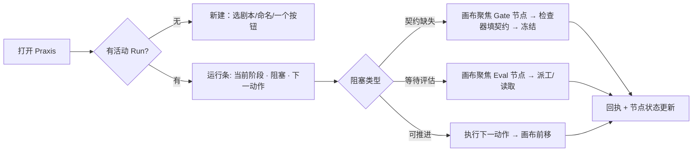
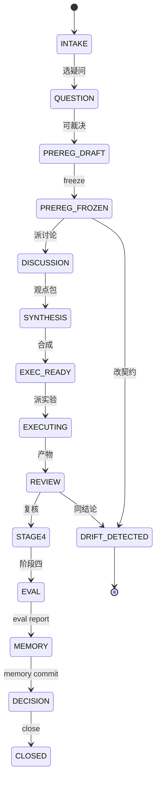
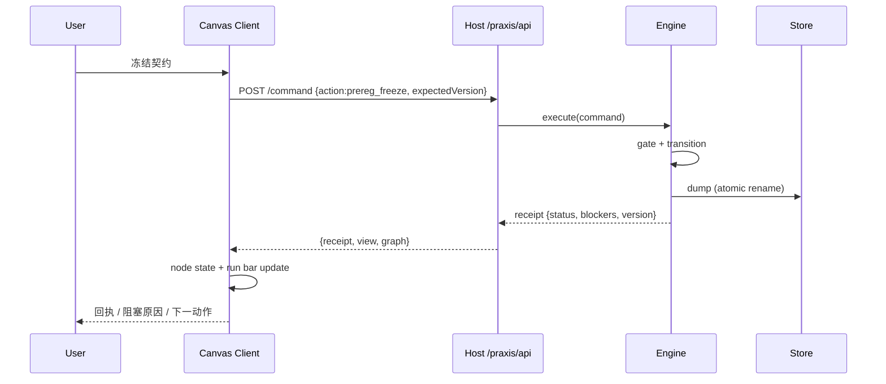
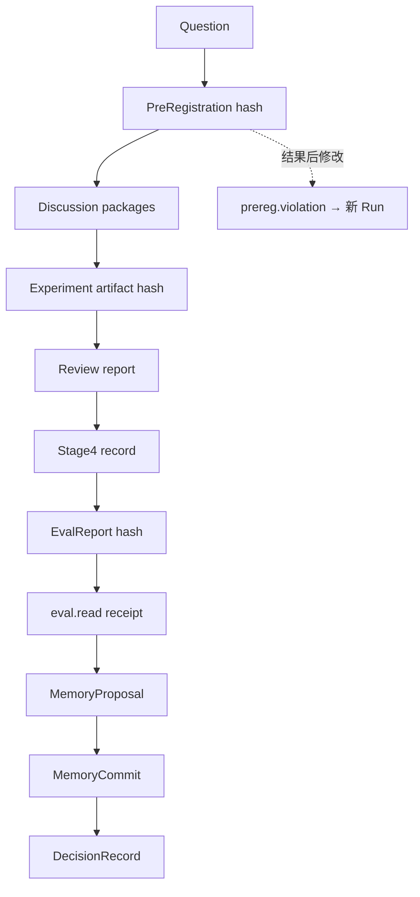

# Praxis 再设计简报（2026-11-04）

> 原则：注意力管理是第一约束。结构跟随决策链，不跟随对象清单。
> 目标：把“状态仪表盘”改为“流程工作台”。设计不是一次定稿；以下为 v2 基线，允许被证据推翻。

## 0. 目标函数

```text
J = 0.25·决策质量 + 0.20·证据完整性 + 0.15·可演化性
  + 0.10·可恢复性 + 0.20·注意力效率 + 0.10·审美一致性
约束：
  C1 硬门不可违背（预注册、真实数据、独立评价、不可自改内核）
  C2 任何模型可见事实必须可从 Session/回执重建
  C3 画布上的每个元素必须对应一个决定或一个状态
  C4 默认隐藏，按需展开；技术细节不进主视线
```

代理指标禁令：不得用“字段数、页面数、测试数、截图数”替代 J。验收看操作成本与决策质量。

## 1. 注意力地图（打开 → 下一个决定）



用户默认只看到：运行条、画布、选中节点检查器。其余（Run 列表、审计、源码、设置）是抽屉。

## 2. 状态机（画布即状态机）



节点状态：`pending`（未到）灰、`active` 青、`blocked` 琥珀、`failed` 红、`quarantined` 斜纹、`done` 绿。只高亮已走路径。

## 3. 通信时序



失败语义：`unknown` 显示为未知；`conflict` 要求刷新；`denied` 显示原因码；不伪造成功。

## 4. 证据链



审计视图只回答：哪条结论缺少独立证据；其余折叠。

## 5. 画布规格（v2 基线）

| 区域 | 内容 | 默认 | 交互 |
|---|---|---|---|
| 运行条（顶） | 当前阶段 / 阻塞数 / 下一动作 / 版本 | 常驻，单行 | 点击阻塞聚焦节点；点击动作执行 |
| 画布（中） | 阶段节点 + Gate 节点 + 类型化边 | 常驻 | 拖节点、滚轮缩放、拖背景平移、端口连线、框选 |
| 检查器（右） | 选中节点的契约/产物/证据/动作 | 常驻，空态隐藏 | 表单只在需要时展开；技术细节折叠 |
| 调色板（左） | 可拖入的节点模板 | 抽屉 | 拖入画布生成节点 |
| 源码（底/侧） | JSON 图定义 | 抽屉 | 编辑 → 校验 → 应用；与画布同源 |
| Run 列表 | 切换/新建 | 抽屉 | 选择即 activate |
| 审计/设置 | 事件、旋钮 | 抽屉 | 按需 |

节点解剖：

```text
┌─────────────────────────────┐
│ ● 阶段名            [状态]  │  ← 8px 状态点 + 名称 + 一个小量（如产物数）
│ 契约: 2/3 · 证据: 4         │  ← 一行关键计数，不列字段
│ ○ input        output ○     │  ← 端口（类型化）
└─────────────────────────────┘
```

缩放 LOD：

- `zoom < 0.6`：只显示名称 + 状态点；
- `0.6–1.2`：+ 一行计数；
- `>1.2`：+ 端口标签。检查器始终显示细节。

键盘：Tab 遍历节点；Enter 打开检查器；方向键移动选中的节点（Shift 加速）；`/` 聚焦运行条；`Esc` 关闭抽屉。画布必须提供等价列表视图（无障碍与窄屏）。

## 6. 接受标准

| 指标 | 阈值 |
|---|---|
| 冷启动完成“新建 → 冻结 → 看地图” | ≤ 5 次操作 |
| 单屏可见决策字段 | ≤ 12 |
| composer dock 冗余标题 | 0 |
| 阻塞可从运行条一屏读出 | 是 |
| 画布非法连线 | 当场拒绝并给原因 |
| 源码编辑与画布 | 同 schema，双向一致 |
| 亮/暗截图 | 每视图至少一张 |
| 窄屏 | 自动降级为列表视图 |

## 7. 再设计循环

1. 原型（3 态）→ 截图评审 → 改结构；
2. 实现 → 冷启动脚本 → 改交互；
3. 测试 → 发现契约缺口 → 改图模型；
4. 每轮记录“发现的问题 / 新思考 / 决定”，不把设计当一锤定音。
