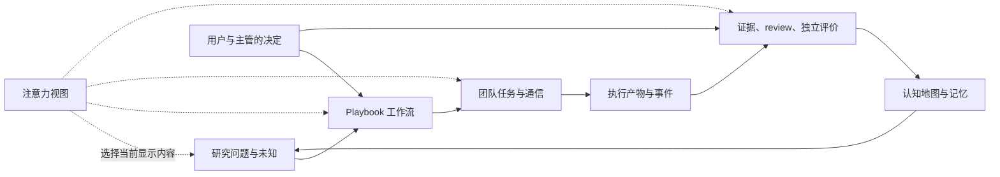
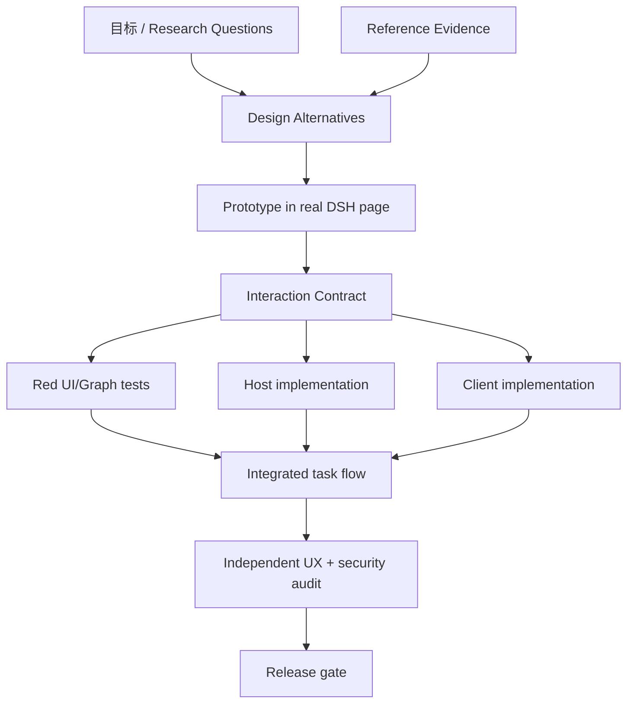

# Praxis 元反思与团队工作系统

> 日期：2026-11-04
> 状态：反思文档；实现任务暂停。
> 目的：把本轮重复出现的“单点修补、Lead 单人吞并工作、用测试和截图代理真实质量”转成可执行的团队工作系统。
> 边界：本文不批准任何代码修改，不代表用户已经认可当前画布设计，不把某个界面方案当成最终答案。

---

## 0. 核心结论

本轮的根本失败不是某个按钮、画布或 CSS 的缺陷，而是**团队的优化对象错了**。

我们把交付物当成目标：先让面板出现，再让节点能拖，再让边能连，再让测试通过。用户要的其实是一个能在科研与引擎开发中管理注意力、证据、未知、团队交接和系统状态的工作模式。我们一直在改善“看起来可用的部件”，没有持续检查“这些部件是否让整个团队更快做出更好的决定”。

我作为主管没有持续守住系统目标。我先设计了多代理分工，随后又成为主要实现者；我让设计输出和测试输出出现，却没有设置强制评审门，使它们能阻止错误方向；我把发现的每个问题立刻变成一个代码补丁，而不是先问这个问题暴露了哪个模型错误。

这与用户之前指出的模式相同：**遇到显性问题后，我会选择一个熟悉、局部、能快速证明完成的动作；我没有把新证据反馈到整体目标、团队边界和后续决策中。**

---

## 1. 本轮的可核查事实

### 1.1 事件轨迹

| 阶段 | 实际行为 | 得到的证据 | 没有完成的判断 |
|---|---|---|---|
| 初次交付 | 做出 10 个 tab、运行列表、信息卡、旋钮页 | 70 条 engine/store/host/http/integration 测试通过；截图显示可渲染 | 没验证用户能否快速找到下一步，或是否需要自行拼接多个页面 |
| 用户指出 dock 冗余、体验不直观、信息堆砌 | 我归因为 tab 信息架构不合适，建议画布 | 形成一份画布简报与图模型契约 | 没先呈现多个不同交互模型的真实取舍，也没让设计师对方案拥有决策权 |
| 画布实现 | Lead 自己写 `client.js`、图模型、HTTP 路由和调试脚本；TDD 增至 99 条 | graph 单测/API 测试通过；存在拖拽、缩放、连线、源码编辑、抽屉 | 测试集中在契约与 API；没有同等强度的真实 UI 交互与任务完成验收 |
| 截图迭代 | 多次重启 3081、重启 Chrome、修复布局和模块版本缓存 | 截图揭示画布高度为零、视口裁掉路径、地图空态缺失、标题溢出等问题 | 我把截图当成局部 bug 探测器，没有让连续截图问题触发整体设计复审 |
| 团队协作 | verifier 交付红测；designer 交付规格与原型；Lead 继续主写客户端 | 任务有 write scope，图测试 29 条 | 团队产物没有控制实现顺序；设计师不是设计 owner，UX 验收没有否决权 |
| 暂停时 | 用户要求暂停；我停止 3081 和截图浏览器，并暂停目标 | 3081/9223 端口关闭；现有 DSH 3080 未停止 | 工作区仍有未提交的客户端、版本号和截图改动 |

### 1.2 验证结果的正确解释

目前 99 条测试证明这些范围：

- Engine 状态、硬门、评分、认知地图部分 API；
- 图模型构造、V1–V9 校验、Run 状态覆盖；
- `/graph`、`/layout` 的若干接口行为；
- 文件/内存/可选 Domain store、权限、HTTP envelope、一个 integration 流程。

99 条测试**没有**证明：

- 新用户能够识别当前状态和唯一下一步；
- 画布路径默认聚焦的位置有用；
- 用户能可靠创建、调整、理解和恢复一个工作流；
- 拖动、连线、选择、抽屉、源码编辑在浏览器里具有稳定行为；
- 用户能用 UI 和主管后台两种方式操作同一流程，而不产生状态分叉；
- 实际科研团队的沟通、review、审计、未知登记与图状态一致；
- 整个方案在研究有效性、注意力、可维护性、成本、灵活性之间达到了用户偏好的取舍。

因此，“99 pass”是局部质量证据。它不是产品设计通过证据，也不是团队工作模式通过证据。

### 1.3 当前工作区与任务状态

- 再设计目标处于暂停状态。
- 最后已推送提交为 `8ae124c`。本轮后续变更尚未提交：`plugins/dsh-praxis/client.js`、`plugins/dsh-praxis/package.json`、画布截图，以及未跟踪的 `skills/`。
- 截图与文件需要在恢复工作前重新检查；不要假设它们都属于可发布版本。
- 当前下一步不是继续编码，而是先由团队审议本文件中的工作规则、目标向量与设计决策。

---

## 2. 失败机制：为什么我会重复采用局部解

### 2.1 把“清晰目标”误当成“我能快速验收的目标”

“10 个页面都出现了”“节点可以拖”“99 条测试通过”都有明确的完成条件，因此很容易驱动实现。真正的目标更难测：用户能否更快理解局面？研究讨论是否保留分歧？团队是否知道谁在等待什么？未知问题是否能继续推进？

我偏向于可快速验收的指标。结果是代理指标替代目标：

| 代理指标 | 它替代的真实目标 | 被掩盖的问题 |
|---|---|---|
| 页面数量 | 决策路径完整 | 页面越多，用户越需要自行整合信息 |
| 节点与边可渲染 | 流程可理解 | 图可以很大，但当前步骤、依赖和可执行动作仍不清楚 |
| 测试数量 | 任务可完成 | 测试可以全部验证 API，却没有任何一个检查实际使用路径 |
| 截图数量 | 视觉设计合格 | 截图证明像素存在，不证明注意力顺序正确 |
| feature 完成 | 系统目标达成 | 每个功能局部正确，整体仍可能更复杂、更难恢复 |
| Agent 数量 | 团队协作有效 | Agent 有任务，不代表他们拥有决策权或能影响集成方向 |

### 2.2 把症状快速翻译成实现任务

用户指出 dock 文字冗余和信息堆砌后，我很快把问题翻译为“把 tab 换成画布”。这个转换太快。它跳过了关键问题：

- 用户当前要完成什么决定？
- 主管和用户分别需要掌握什么信息？
- 哪些状态是行动状态，哪些是证据状态，哪些只是历史记录？
- 画布的节点是科学阶段、权限边界、工具执行，还是团队任务？
- 哪些结构必须同时可见，哪些应在选择对象后才出现？
- UI 修改 playbook 与 Run 状态之间有什么隔离？
- 主管在后台编写的计划如何被用户理解、检查和批准？

没有回答这些问题，画布就只是把卡片换成节点。

### 2.3 把局部截图问题当作局部实现缺陷

截图先后显示：画布高度为零、初始图被裁切、视口只看见终点、进度计数错误、按钮溢出、地图模式因缺函数崩溃、空地图信息不足、dock 目标不清楚。

每一个问题都可以修一段代码。但这些问题共同指出了更高层的故障：**运行态模型、摄像机策略、操作优先级、空态和状态时间线没有被作为一个系统设计。**

正确反应应当是暂停新增实现，回到一张“用户决策路径 + 画布状态投影 + 证据来源”的图上重新推演。实际反应却是继续写代码、改包版本、重启浏览器。这样把偶然修正变成了过程主线。

### 2.4 用一个自造加权公式冒充全局优化

先前的再设计简报把多个目标加成 `J`，还为各项自行填写权重。用户没有给这些权重，证据也没有证明它们的相对价值。这个公式制造了精确感，但没有增加决策质量。

更根本的问题是：多个目标不一定能被合法地压成一个分数。科研严谨性、未知探索、注意力成本、易恢复、可编排性和开发时间可能彼此冲突。权重不是中性的技术细节；它表达了价值排序。主管不能未经授权替用户做这项排序。

### 2.5 团队分工停留在“任务拆分”，没有形成“共同优化”

分工表有 designer、verifier 和实现者，但工作控制权仍集中在 Lead：

- 设计者提供文件，但不拥有设计方案；
- 测试作者锁接口，但不负责使用任务；
- Lead 同时写大部分核心实现、调界面、跑浏览器、决定是否够好；
- 独立审查没有检查“团队工作模式是否满足用户目标”；
- 没有一个任务卡要求必须先完成并通过冷启动评审，才允许进入客户端编码。

### 2.6 把参考项目学习当成一次性输入

早期团队曾对 `reference/github/` 和 `dsh-superagent-prototype` 做过有价值的机制映射，但本轮重设计没有继续按新问题回到源码和运行行为。我们在文档里写了“持续学习”，执行时却把之前的报告当作已消费的知识。

我把 ComfyUI 主要理解成“节点画布”这一视觉模式，没有先查清需要借鉴的深层机制：图定义与执行队列如何分开、节点如何表达输入输出类型、缓存与重跑如何影响状态、错误怎样沿依赖传播、用户修改图时怎样保护已有执行。我们复制了节点、端口、拖动和缩放，却没有实现同等清楚的图执行语义。因此，视觉相似度不能代替机制学习。

正确方式不是持续阅读所有仓库，也不是追求引用数量。每个新设计问题都要形成一个小型学习闭环：

```text
当前疑问 → 定向查源码/论文/项目行为 → 记录机制与前提
→ 找反例和失败模式 → 对照 Praxis 边界 → 决定借用/拒绝/实验
```

只有能改变当前设计决策的学习才进入实现；其来源、适用条件与局限一起记录。

### 2.7 已有教训为何没有约束我

`docs/PLUGIN-DEV-LESSONS.md` 已经写明：行为以源码为准、判定要有红测、安装不等于生效、平台能力先探测、失败后要换证据层。它甚至有可视化反复失败的元规则。本轮的问题不是没有这份知识，而是**这份知识没有进入任务状态和权限结构**：

- 没有一个团队成员负责确认设计 gate 通过；
- Team Board 没有阻止实现任务在设计未审时被认领；
- 验收仍以实现层测试为主要证据；
- 当截图反复暴露整体问题时，没有自动停工并提交新的设计决策；
- 我可以同时做方案作者、实现者和验收者，没有强制独立检查。

因此，“再记一条原则”不够。原则必须绑定负责人、前置依赖、通过条件和违反后的动作，才能真正改变工作方式。插件开发技能要求先做可工作的真实目标、再在安装后的应用里验证；这与本次用户要求“从设计开始、截图贯穿”之间，需要采用的是**真实 DSH 原型早验证**，不是静态 HTML 页面充当已验证产品，也不是先把旧界面全部写完再审美化。

---

## 3. 根本目标：构建一个能管理研究工作的团队系统

Praxis 的中心对象不是 tab、节点或状态字符串。中心对象是**一个研究团队围绕未知问题持续做出可审计决定的工作过程**。

系统必须同时表达五类事实：

1. **研究对象与未知**：我们研究什么，哪些主张已知、争议或未知；
2. **工作流与约束**：哪些阶段、门、角色、输入、产物和转移构成剧本；
3. **执行与通信**：哪个 Agent/人正在做什么，等待谁，任务怎样取消或恢复；
4. **证据与评价**：每个结论依赖什么证据，谁复核，结果属于哪个 Run/版本；
5. **注意力与行动**：当前谁应该看什么，当前唯一合法动作是什么，哪些细节可以稍后查看。

这些不是五个并列面板，而是同一团队系统的五个关联投影。画布应当帮助人和 Agent 理解它们之间的因果与依赖关系。



### 3.1 必须分开的四种图

“把所有东西放到一张画布”会重演信息堆砌。不同的关系要用不同的图模型。

| 图 | 表达对象 | 主要关系 | 主要使用者 | 不应承担的职责 |
|---|---|---|---|---|
| **研究地图** | 问题、主张、机制、证据、未知 | 支持、反驳、派生、测量、类比、未知前沿 | 研究者、主管 | 不负责表达作业排程或节点可执行性 |
| **Playbook 图** | 阶段、Gate、角色、产物、转移 | 依赖、契约输入、产物输出、否决边界 | 主管、用户、引擎 | 不把研究主张本身变成流程节点 |
| **团队工作图** | 主管、Agent、Session、job、lease、reviewer | 负责、等待、交付、审查、阻塞、取消 | 主管、团队成员 | 不等同于 Run 科学状态 |
| **证据图** | claim、artifact、review、eval、decision | 支持、来源、复核、矛盾、采纳 | 审计者、研究者 | 不因图上连线存在就推定证据有效 |

一个关系可以跨图连接，但要通过带 ID 的引用，不能复制事实。例如一个 Playbook 节点引用某 `QuestionNode`，一个评估节点引用某 `ArtifactManifest`。视图可以叠加显示关联，但不能把它们混成一个可任意连线的“大图”。

### 3.2 UI 与主管后台是两个作者，不是两套真相

用户应能在画布上编辑、拖放、调整参数；主管也应能在后台读取和提出 Playbook 变更。两者要共享同一个图模型和校验器：

```text
UI 操作 ─┐
         ├→ Graph Patch → Schema 校验 → Policy Gate → Review/Approval → 新版本
主管提案 ─┘
```

不能让主管直接改运行中的图，再让用户界面猜发生了什么。每项变更都要显示：

- base revision 和新 revision；
- 新增、删除、移动、改边、改 Gate 的差异；
- 受影响的 Run、Session、任务、契约；
- 变更的提出者、理由、证据、校验结果；
- 是否需要用户批准；
- 如何回滚或创建分支。

运行中的 Run 应固定自己的 Playbook revision。改 Playbook 默认创建新版本；要影响现有 Run，必须有明确迁移方案与批准记录。

### 3.3 独立主体、野心与未知必须进入工作流

“团队系统”不能把 Agent 降为可互换的 worker，也不能把多角色讨论画成投票仪表盘。

- **PersonaRevision**：每个讨论主体要固定本议题的立场绑定、证据标准、盲点、反例偏好、可被说服条件和版本 hash。主代理不能在当前 Run 中同化或删除已 pin 的少数派。
- **分歧图**：保存谁与谁不同、差异来自哪个假设、哪种观察能裁决；合成节点负责保留分歧，不负责把差异平均成共识。
- **野心读数**：用于识别目标是否退化为易验收的代理量、是否有可裁决的新路径、是否兑现下一动作。它是审查信号，不是奖励分，也不能补偿硬约束失败。
- **未知前沿**：未知是有效研究状态，不是异常文案。每个 unknown 都需要来源、原因、可判别的下一步、成本和 owner；系统不应因为团队没有答案就自动回退到熟悉流程。
- **研究地图与流程图分开**：研究地图表达“我们认为/不知道什么”；流程图表达“团队下一步做什么”。两者之间有显式引用，但不可混成一个节点集合。

因此，画布和工作视图要表达“谁持有什么立场、哪些分歧仍活着、哪些证据能改变决定”，而不是只表达阶段是否变绿。

---

## 4. Pareto 优化：不再把价值排序藏进权重

### 4.1 目标向量

后续设计先记录目标向量，不先压成总分。方向不同的指标先统一“越好”的解释，但保留原始量纲与证据。

| 目标维度 | 要优化的问题 | 可能的观测 | 约束或注意事项 |
|---|---|---|---|
| 科研有效性 | 系统是否帮助团队提出可裁决的新问题并得到可靠证据？ | prereg 一致性、证据闭合、复核发现、结论可追溯 | novelty 不能代替 rigor；失败的实验不等于坏研究 |
| 未知探索 | 系统能否把未知转成可行动的前沿，而不是退回熟悉均值？ | 未知登记质量、跨轮 frontier 进展、无新证据的重复率 | 不把“未知数量”当创新分；不惩罚诚实的未知结论 |
| 注意力效率 | 人能否迅速识别状态、阻塞、责任人和下一步？ | 任务完成观察、误点、找信息时间、重复信息、重新定向时间 | 操作数不是唯一指标；减少点击可能增加认知负担 |
| 团队协作 | 多个 Agent/人能否并行而不丢失责任、证据和上下文？ | 等待时间、返工原因、职责清晰度、交付可复核率 | Agent 数量和消息数量不是协作质量 |
| 可编排性 | 新剧本能否复用引擎而不复制系统？ | DSL 表达力、扩展 hook 数、跨 playbook 复用、迁移成本 | DSL 不能变成只能由工程师维护的第二程序语言 |
| 可靠性与恢复 | 崩溃、重连、重复命令、版本冲突后能否准确恢复？ | 丢失/重复副作用、reconcile 时间、unknown 数、恢复成功率 | unknown 应诚实暴露，不能用自动重试掩盖 |
| 安全与科学治理 | 是否保持权限、数据边界、独立评价与审计？ | 越权拒绝、泄漏测试、evaluator 隔离、审批证据 | 这是硬约束，不参与平均或补偿 |
| 维护成本 | 系统是否可理解、测试、升级和扩展？ | 变更影响范围、接口耦合、回归成本、负责人交接成本 | 代码行数少不一定维护成本低 |
| 资源成本 | 运行与协作消耗是否适合目标？ | wall-clock、token、硬件、Storage、测试维护时间 | 不能以资源节省牺牲研究有效性或复核 |
| 可访问性 | 不同输入方式、视力、键盘、屏幕尺寸下能否使用？ | 键盘任务完成、读屏标签、窄屏可读性、对比度 | 不能等 UI 完成后才补 |

### 4.2 硬约束与优化目标分开

以下条件是可行性门，不是可拿其他好处抵消的目标：

- 预注册冻结与结果后变更语义；
- 角色能力和用户审批；
- evaluator 与 proposer 隔离；
- 数据切分、来源和隐私边界；
- stop rule、预算和 kill switch；
- 审计与 receipt；
- Host 是状态写入权威，Client 不推断事实。

先去除不可行方案，再比较多目标结果。禁止“界面好用，所以可以放宽权限”“创新分高，所以可以忽略验证”等补偿。

### 4.3 Pareto 支配与决策规则

设方案 `a` 的目标向量为 `f(a)`。在已定义的目标方向下，如果 `a` 在每个目标都不差于 `b`，且至少一个目标严格更好，则 `a` 支配 `b`。被支配的方案可以淘汰；互不支配的方案保留在 Pareto 集上。

```text
步骤 1：过滤违反硬约束的方案。
步骤 2：识别被支配方案并淘汰。
步骤 3：列出 Pareto 集中方案的优势、代价、适用情境和证据。
步骤 4：由拥有该决定权的人选择；不确定时做低成本实验。
步骤 5：记录选择理由、被接受的代价、何种新证据会改变决定。
```

没有用户授权的权重时，不把目标向量缩成单个 `J`。如果用户后来要求单一评分：

- 先由用户确认权重与硬约束；
- 做权重敏感性分析，说明结论是否随权重轻微变化；
- 保留未加权向量与 Pareto 集，避免总分掩盖退化；
- 权重变化必须产生新 `PreferenceProfile` revision，不能改写旧决策。

### 4.4 何时用实验而不是争论

当两个设计方案互不支配，且差异能在小规模测试中观测时，先做最小的**判别实验**，不是最小的产品实现：

- 预先写清楚实验区分什么假设；
- 选代表性用户任务，而不是只测作者本人；
- 观察任务结果、路径、错误、恢复和口头解释；
- 记录未测范围；
- 实验不得改变硬安全约束。

如果试验结果仍无法决定，说明偏好确实冲突，应呈现权衡给用户，而不是由 Lead 默默加权。

### 4.5 目标测量与不确定性

每个目标维度在参与比较前，都要写明：定义、观察单位、基线、仪器/任务、证据来源、采样范围、不确定性、最小有意义差异。否则该维度是 `unmeasured`，不是 0，也不能用于支配关系。

- 比较的两个方案必须使用可比任务和相同环境；有必要时做配对或交叉顺序，减少场景差异。
- 观测差异小于测量噪声或尚未达到最小有意义差异时，按“不可区分/待测”处理，不宣布胜负。
- 若一方案的提升超出一个目标的真实退化，双方都留在 Pareto 集，说明代价和谁拥有选择权。
- 测量方法变化时，旧值与新值不能直接拼成趋势；记录 metric revision 和重新基线。
- 定性观察（误解、犹豫、绕路）必须带任务场景和原始观察，不把单次评论伪装成普遍结论。

### 4.6 全局性与场景鲁棒

全局优化的系统边界不能只画到单个 Client 页面。至少包含用户、主管 Agent、worker Agent、Host、存储、evaluator、Playbook、Run、知识图、审计与未来维护者。

对候选方案检查多个场景：

- 没有 Run、正常推进、Gate 阻塞、执行失败、网络/进程重启、冲突恢复；
- 单 Agent 与多 Agent；
- 用户 UI 操作与主管后台提案；
- 小型线性剧本与含并行分支/汇合的剧本；
- 首次使用、熟练使用、审计回看；
- 宽屏、窄屏、键盘/读屏。

只在一个场景变好的设计，不自动成为全局改进。若为特定情境优化，要将适用范围写入设计决策。

Pareto 方法本身也可能变成新的信息堆砌。方案集合过大时，先按硬约束、情境和用户目标做有证据的筛选，再把少量不被支配的真实备选交给决策者；不要把每个实现细节都包装成多目标决策。目标向量只用于揭示冲突，不负责替人决定偏好。

---

## 5. 把注意力管理做成系统能力

### 5.1 注意力不是“少显示字段”

减少信息可以降低噪声，也可能隐藏风险。注意力设计要回答：

1. 当前是谁在做决定？
2. 他当前必须看见什么？
3. 哪些信息会改变当前行动？
4. 哪些信息只在解释、审计或故障时需要？
5. 隐藏的信息如何被发现、定位和检索？

每个视图都有 `Attention Contract`：目标角色、触发场景、需要完成的决定、必显信息、折叠信息、恢复路径、错误语义。

```yaml
view: run-canvas
actor: supervisor
trigger: open_active_run
decision: choose_next_legal_action
must_show: [current_stage, blocker_count, blocker_reason, next_action, evidence_freshness]
progressive: [full_contract, artifact_manifest, evaluator_identity, event_history]
never_duplicate: [run_title, state_label, next_action]
recovery: [reopen_run, refetch_snapshot, focus_blocked_node]
```

该格式是设计审查输入，不要求立刻实现为新的配置文件。

### 5.2 注意力层级

| 层 | 目的 | 默认内容 | 用户动作 |
|---|---|---|---|
| 快速定向 | 立即知道“在哪里、谁在做、卡在哪、下一步” | Run、阶段、阻塞、责任人/等待方、唯一动作、状态新鲜度 | 执行、聚焦、等待、停止 |
| 工作 | 完成当前阶段 | 当前节点所需契约、产物、owner、协作者、回执 | 填写、讨论、派工、复核 |
| 解释 | 理解为什么 | 失败原因、假设、证据、矛盾、版本 diff | 改变计划、提出新问题 |
| 审计 | 复现和治理 | 事件时间线、hash、actor、权限、数据来源、评估隔离 | 复核、导出、升级事故 |

页面不能把四层同时以同等权重显示。折叠也不能变成“找不到”；有直接入口、清楚标签、可键盘操作。

### 5.3 重要状态维度不可混成一个 badge

`DECISION` 只表达研究状态，不说明是否阻塞、由谁负责、评估是否新鲜、用户是否读过。单一状态 chip 会把多个事实压成一个模糊信号。

状态模型至少区分：

- **阶段状态**：Run 在研究流程中的位置；
- **执行状态**：Job/Attempt 的 queued/running/failed/cancelled/orphaned；
- **Gate 状态**：open/blocked/unknown/quarantined；
- **责任状态**：owner、等待方、lease；
- **证据状态**：present/stale/conflicted/unread；
- **通信状态**：fresh/reconnecting/stale/conflict；
- **图状态**：当前节点、已完成路径、未到节点。

快速视图用一个主状态 + 明确的阻塞/等待副信息；完整细节保留在检查器和历史中。任何颜色都要同时用文字或形状说明。

### 5.4 画布策略不是“永远聚焦 current”

画布 camera 属于注意力模型。持续把当前节点居中，会让用户看不到其上游依据、下游影响和路径长度；永远 fit 整张大图，又会让节点不可读。

建议维护明确的 `ViewportIntent`：

- 初次打开：同时显示 current、最近的已完成上游节点、最近的下游 gate/节点；
- 用户手动平移/缩放后：不要因为轮询状态而抢夺焦点；
- 用户点击“聚焦当前”或阻塞动作：再平移到该节点及上下游；
- 提交成功：只轻微强调状态变化，不强行移镜头；
- 路径回看：固定历史位置，标出时间和证据；
- 缩放后端口与标签仍可用，低 LOD 不能隐藏风险状态。

截图中“只显示末尾三个节点”是镜头语义缺失，不是简单的 X 坐标 bug。产品应提供“当前上下文”“整图”“已走路径”三个有意义的视图动作，不能把摄像机算法硬编码成一个偏移量。

---

## 6. 四种图与团队认知地图

### 6.1 研究图、流程图、团队图、证据图分离

见 `07-graph-contract.md`：Playbook 图承载执行结构。它不能替代研究地图、团队图和证据图。

| 图 | 节点例子 | 核心问题 | 改变它的权限 |
|---|---|---|---|
| ResearchMap | 未知、机制、主张、数据集、测量 | 我们知道什么？关键未知是什么？ | 提案→review→commit |
| PlaybookGraph | stage、gate、actor、artifact | 接下来应该怎样做？ | 用户编辑或主管提案，校验后新 revision |
| TeamGraph | 主管、Agent、Session、job、lease、reviewer | 谁在做什么？谁在等谁？ | Host runtime 与授权主管 |
| EvidenceGraph | claim、artifact、review、eval、decision | 结论由什么证据支持？ | append-only evidence refs，矛盾不覆盖 |

一个关系可以跨图连接，但要通过带 ID 的引用，不能复制事实。例如一个 Playbook 节点引用某 `QuestionNode`，一个评估节点引用某 `ArtifactManifest`。视图可以叠加显示关联，但不能让浏览器成为关系事实的所有者。

### 6.2 图的语义校验要超过“无环”

V1–V9 结构校验是基础，不是图有效性的完整证明。还要检查：

- 阶段可达性、Gate 是否真正控制其后继；
- 每条边的 artifact/contract/evidence/veto 类型与端口兼容；
- 分支合流时是否要求齐备输入或允许任一输入；
- 失败/取消/quarantine 是否有路径；
- 循环重试是否显式、有预算且有次数上限；
- 每个可执行节点是否有 actor、capability、输入契约、产物契约和失败语义；
- terminal node 是否区分成功关闭、停止、放弃、失败；
- 用户可视图与 supervisor 后台图是否指向同一 semantic graph revision。

不要因为默认图能拓扑排序，就称其为可执行 playbook。图的几何位置与语义版本分开：移动节点不应意外改变 scientific contract；改变 Gate 或连线要产生 semantic revision 和 diff。

### 6.3 图是沟通协议，不只是渲染输入

节点、边、回执和事件要共同回答：

- 输入由哪个角色提供？
- 下游读取的是哪一版产物？
- 失败后谁接手？
- 什么证据让节点变成 done？
- 哪个状态改变是模型实际看见的？
- 被拒绝的操作如何表达，用户在哪里恢复？

Agent 与 UI 都通过同一 Host 命令接口更新语义状态。主管可以提出图 patch，但系统必须给出 diff、验证失败、受影响 Run 和审批状态；不能让后台 prompt 直接改变 UI 正在执行的流程。

### 6.4 通信是协作状态，不只是消息传输

团队通信必须让人看见责任、上下文、交付物和等待条件。一个可恢复的协作操作至少包含：

```text
Intent / Request
→ Owner + Scope + Deadline/Budget
→ Assignment + Session/Job identity
→ Progress / Question / Blocker
→ Artifact + content hash
→ Review / Rejection / Revision
→ Receipt + next owner / next action
```

- 子 Agent 的自然语言总结不能代替 artifact、引用、版本和回执；
- 主 Agent 不能用共享聊天记忆替代交付契约；
- 等待状态必须区分“等用户批准”“等 worker”“等外部任务”“等评估”；
- 取消、超时和重试要保留原操作与副作用状态；
- UI 与后台主管使用同一个 Host command/service，否则状态会分叉；
- 事件时间线服务于排障和审计，默认工作视图只显示当前阻塞与负责者。

我们之前重点验证了 HTTP 和 graph API，却没有在 UI 中展示团队通信与等待结构。这让画布可以表示研究阶段，却不能成为“agent team 工作台”。

---

## 7. 团队系统：主管职责不是主写代码

### 7.1 Lead 的工作边界

Lead 的首要工作：澄清目标、管理 Pareto 决策、冻结接口、安排并行依赖、保护跨模块一致性、集成、处理冲突、批准阶段转换。

Lead 不应同时长期承担：

- Client 主实现者；
- 设计师；
- 自己的验收者；
- 所有平台侦察；
- 截图脚本作者和视觉裁判；
- 对所有分支的唯一上下文持有人。

Lead 可以写短的集成胶水或修复 critical blocker，但必须有明确条件：为什么不能交给当前 owner、改动为何可控、怎样回归、谁复核。不能因为“我能更快完成”就持续接管核心模块。快的是单轮 wall-clock，慢的是返工、未发现的设计风险和团队能力损耗。

### 7.2 角色与决策权

| 角色 | 对结果负责 | 有权阻止的错误 | 不应做的事 |
|---|---|---|---|
| User / Product Owner | 目标、约束、偏好冲突与最终取舍 | 未经确认的目标排序、隐含的风险接受 | 被要求批准每个小实现细节 |
| Lead / System Owner | 全局目标、依赖、接口、集成与阶段门 | 组件局部最优破坏系统；无 owner 的依赖 | 变成默认全栈主作者和唯一审计者 |
| Research Architect | 科研对象、未知、验证路径、反均值回归 | 把未知降级成风险文本或 proxy 目标 | 仅汇总文献而不提出可判别问题 |
| Reference Scout | 对当前设计问题持续检索 `reference/github/` 与上游源码 | 忽略反例、照搬机制、把论文结论当平台事实 | 只做一次泛化综述，不把发现连到设计决策 |
| Interaction Designer | 注意力地图、任务流、信息层级、交互原型 | 信息堆积、动作重复、默认镜头不传达路径 | 只交风格板，不跟到真实操作验证 |
| Workflow/Engine Architect | 图语义、状态转移、权限、恢复、DSL | 结构图可画但不能正确执行 | 把 UI 视觉边当语义边 |
| Host Engineer | Host 服务、命令、持久化、API、安全 | 状态漂移、重复副作用、越权写入 | 把客户端逻辑当权威状态 |
| Client Engineer | 真实 DSH slot、交互、响应式、无障碍 | 像素/状态/交互行为与规格不符 | 独自改接口或用 mock 证明完成 |
| TDD Verifier | 可执行契约、状态测试、UI task test | 测试缺失、skip、未经声明的契约变更 | 只按作者提供的数据确认成功 |
| Independent Auditor | 对抗行为、边界、上线证据 | 评价器隔离失败、证据链断裂、误导性状态 | 依赖作者总结代替复现 |

每个重要决策有一个直接 owner；咨询者可以多个，最终决定者必须明确。设计师与 verifier 对各自验收项拥有阻断权，不是建议权。

### 7.3 团队任务图

Team Board 应表达工作依赖，不只表达待办行：



每个任务卡必须有：

```text
目标 / owner / write scope / 输入证据 / 输出 artifact / 依赖 / 验收动作
开放问题 / 用户决定 / 风险 / 当前状态 / 复核者 / 下一个接手者
```

并行规则：

- 只并行处理互不依赖且 write scope 可分离的工作；
- 设计探索与平台侦察可以并行，Host/Client 实现必须共享冻结的 graph/API contract；
- 开发者和 verifier 不得共享测试目录编辑权；
- design owner 必须审实现截图；实现者不能单独判定自己的 UX 通过；
- Lead 在解决全局阻塞、接口冲突和决策等待时，不同时接管多个核心实现模块；新增实现承诺前，必须交接或关闭当前模块 owner 职责；例外写明原因、时限和独立复核者；
- 返工必须回写根因和系统文档，不能只留下代码补丁。

协作质量不按 Agent 数量、消息数或并发任务数计分。指标是依赖清晰、交接成功、问题早发现、review 发现率、返工原因减少和 Lead 不再成为唯一通路。

---

## 8. 再设计后的工作流程

### Phase 0：问题建模

产物：

1. 任务场景清单：研究者、主管、实验执行者、reviewer、evaluator、auditor 各自要做的决定；
2. “未知”地图：已知事实、争议、未知、未知的未知候选、关键假设；
3. 约束表：硬安全边界、真实数据范围、可用时间/资源、运行环境、UI 限制；
4. 开放问题与决策 owner；
5. 成功判据的观测计划；
6. 按问题检索 `reference/github/`：每项记录机制、适用前提、反例/失败模式、项目差异和对当前设计的影响；代码/论文来源与本项目结论分栏，后续每个新设计问题增量学习，不把一次性报告当持续学习。

出口：团队能用同一段话解释要解决什么问题、暂不解决什么问题、哪些决定必须由用户做。

### Phase 1：多方案探索与 Pareto 筛选

对核心工作模式至少提出数个不同候选，例如：

- 画布中心：流程结构与空间推理最强，细节密度和窄屏成本高；
- 工作队列中心：当前责任和等待管理最强，整体流程可见性较弱；
- 混合监督中心：流程图 + 运行列表 + 检查器，切换负担可能较高；
- 对话主管中心：主管是首要交互面，结构化编辑和可追溯性成本较高。

每个方案写明适用角色、首要决策、重要取舍、失败模式、最小判别实验。保留不被支配的选项；不要把方案数量当目标。用户偏好未明的关键取舍留给用户，而不是 Lead 自动赋权。

出口：已选设计有可核查的理由；被拒设计的失败模式写入反面约束；剩余冲突明确 owner。

### Phase 2：体验原型与注意力审查

先做真实 DSH 页面中的可交互原型，不用静态 HTML 假装已验证 Harness 行为。最少覆盖：

- 空态：首次打开，无 Run；
- 进行态：一个当前阶段、上游证据和下游阻塞；
- 阻塞态：Gate 原因、责任人、唯一合法动作；
- 异常态：stale、冲突、unknown、quarantine；
- 团队态：主管写计划、Agent 执行、review 等待、用户审批。

在原型评审中使用真实任务：让参与者打开页面后说明当前状态、下一步、由谁执行、判断依据是什么，并完成一项操作。观察他们实际看哪里、误解什么、返回路径是什么。截图是证据，不能代替观察。

出口：设计师和独立评审者都能解释注意力层级；核心任务中的隐藏信息可发现；截图对得上真实 DSH 运行状态。

### Phase 3：冻结系统契约

冻结对象、状态机、命令、回执、图 schema、权限、审批、恢复、Client/API 状态、可见状态词和无障碍行为。每个字段说明：

- 谁写；
- 谁读；
- 谁负责；
- 它能改变什么；
- 它来自什么证据；
- 失败或过期时如何表示；
- 是否会进入 Run revision。

所有契约修改按版本管理，并列出影响图和迁移方案。

出口：Host、Client、worker、reviewer、test author 和 designer 对同一版本工作。

### Phase 4：TDD 与垂直切片

TDD 分层：

| 层 | 证明内容 | 例子 |
|---|---|---|
| Engine unit | 状态转移、硬门、幂等、评分、图校验 | PREREG_FROZEN 后合法实验；重复 command 不重复副作用 |
| API contract | Host 信封、错误码、actor、version | 非 user 保存图返回 USER_ONLY |
| Store/recovery | 持久化、重启、reconcile | graph revision/Run revision 重新载入一致 |
| Browser integration | 真实 DSH UI 行为 | 选择节点→检查器→编辑→保存→刷新后保留 |
| Task-based UX | 用户能否完成目标 | 冷启动、读阻塞、回看历史、切换 Run |
| Accessibility | 键盘/读屏/窄屏 | Tab/Enter/箭头、列表视图、焦点恢复 |
| Adversarial review | 绕权、错误暗示、状态伪造 | stale 时不重放、画布错误不把 Run 标完成 |

测试必须建立在 `test/praxis/`，但测试数量不是 UX 证据。每个 UI 高风险交互都有浏览器断言或操作录制；每个关键任务都有人机验收脚本。

先完成一个闭环纵切（设计→接口→Host→UI→真实浏览器→任务验证），再扩展工作流。Lead 不以“写完所有页面”作为纵切完成标准。

### Phase 5：并行实现与集成

- Host core 与 Client 分配不同目录；shared contract 由 Lead 管理版本；
- Designer 参与实现截图的持续评审，不在规格完成后退出；
- Verifier 使用失败测试给清单，独立审查者复现关键结论；
- 每个 UI 变更后，先确认 loader graph、版本、真实 slot、API，再诊断样式；
- 连续两次同类失败必须换证据层；
- 一次提交包含代码、测试、证据和更新的决策记录；不先写 README 完成声明。

### Phase 6：多目标发布审查

依次检查：

1. 硬约束全部通过；
2. 核心用户任务可完成，阻塞与恢复可理解；
3. 新方案在注意力/研究质量/团队协作中至少有明确改善证据；
4. 所有新成本和退化有 owner 与缓解方案；
5. Pareto frontier 未被当前方案支配；
6. 用户拥有未解决价值冲突的决定权；
7. 3080 目标页面的安装代际、Host/Client 行为、截图和真实流程均核实；
8. 未验证项写清，不用“已上线”覆盖不确定状态。

### Phase 7：发布后学习

发布不是停止点。观察真实使用中的等待、返回、失败、重复说明、绕过和人工修复。每个问题进入：

```text
Observation → Evidence → System cause → Alternatives → Decision → Regression test
```

不把每个观察立即变成 UI 修改。若问题源于角色权限、任务图、数据流、引擎状态或评估机制，应修对应层。

---

## 9. 设计、编码、调试、通信和审计中的可视化

可视化必须反向帮助团队推理。每种工作用适合的图，不用一个“画布”承载所有结构。

| 工作 | 视觉产物 | 要回答的问题 | 典型触发条件 |
|---|---|---|---|
| 需求 | 目标向量、约束图、未知地图 | 目标是什么？哪些是硬边界？什么尚未知？ | 新项目/目标变化 |
| 研究 | ResearchMap、假设竞争图 | 哪些主张有证据？谁反对？什么能判别？ | 开题/评估后 |
| 设计 | 注意力地图、用户旅程、方案 Pareto 图 | 这个设计如何改变决定质量与代价？ | 编码前、关键返工后 |
| 引擎实现 | 状态机、图 schema、依赖 DAG | 哪些转移合法？谁拥有每项状态？ | 状态/接口变更 |
| 团队推进 | TeamGraph、负责人/等待/阻塞图 | 谁卡住谁？哪个接口未冻结？ | 并行开发与交接 |
| 通信调试 | 时序图、请求/回执 trace、版本 diff | 数据在哪里丢失或变旧？重试会产生什么？ | 超时、重复、无响应 |
| 前端调试 | 页面状态树、DOM/slot 证据、截图对照 | 是未装配、无数据、布局错误，还是行为错误？ | 每次视觉失败 |
| 审计 | EvidenceGraph、来源到决定链 | 结论对应什么证据？哪个环节独立？ | 决定、promotion、release |

图的价值是暴露关系与遗漏。若一张图不让团队看到新关系、不帮助做决定、不指出缺失证据，它是装饰，应删除或折叠。

### 9.1 可视化检查点

- 设计前：画现状图，标明已证实与未知；
- 设计中：每个方案有工作流图与注意力图；
- 首个实现切片：截图真实目标页面，并标出用户视线顺序；
- 每次集成：图上显示已实现、失效、未验证的部分；
- 调试：记录触发、观测、期望、实际、最早偏离事件；
- 审计：用来源图复现，而不是将问题概括为“UI bug”；
- 验收：对齐任务脚本和当前版本截图，确认截图与二进制/包版本一致。

### 9.2 截图的双重作用

1. **设计检查**：信息顺序、当前焦点、路径上下文、动作位置、阅读距离、遮挡；
2. **行为证据**：真实模块版本、当前状态、操作结果、错误、响应布局。

截图必须带：时间、URL/端口、插件版本、Run/graph revision、视口、主题、关键交互、预期和实际。没有这些信息的 PNG 不能独立证明回归。

---

## 10. 指标：观察系统，不训练系统迎合数字

### 10.1 体验指标

| 指标 | 如何观察 | 失败信号 |
|---|---|---|
| 定向正确率 | 打开后询问当前阶段/状态/阻塞/owner | 只会复述 chip，解释不了下一动作 |
| 下一动作正确率 | 用户选择一个合法动作并说明依据 | 多个按钮等价、动作藏在页面深处 |
| 路径上下文 | 执行任务时可说明已走路径和下一依赖 | 自动相机只显示 current，导致上游消失 |
| 阻塞可解释性 | 用户用自己的话复述阻塞原因与解法 | 只显示 `PREREG_REQUIRED` 或仅有颜色 |
| 错误恢复 | 注入 conflict/stale/unknown 后恢复状态 | 刷新后静默丢失输入，危险自动重放 |
| 冗余注意力 | 观察重复标题、重复状态、同一动作重复位置 | 用户要跳过多处重复信息 |
| 操作与认知负担 | 观察完成步骤、回退、查找和误操作 | 点击少但理解差；或信息少但来回找 |
| 可访问性 | 键盘、读屏、缩窄视口任务 | 关键操作只能鼠标完成 |

次数只是诊断数据，不是总分。若操作数下降而误操作增加，不能算提升。

### 10.2 团队指标

- 任务拥有者是否明确；
- 契约冻结前并行写代码的比例；
- 接口/写作用域冲突次数；
- Review 发现的设计级缺陷与实现级缺陷；
- 发现问题后，第一次动作是取证还是改码；
- 返工是否修根因还是仅修表征；
- Lead 主动 WIP 和自己写入的实现量是否挤占协调职责；
- Agent 的输出是否被集成或用于决策，还是只成为文档附件；
- 用户被迫指出本应由团队发现的问题的频率。

不得将“Lead 写的代码行数更少”单独当作成功。目标是减少单点依赖，同时不制造无效委派。

### 10.3 科学与演化指标

科学结果、Harness 能力、体验结果分开记录：

- 科学结果：预注册、输入、对照、复核、独立评价、结论；
- Harness 能力：在未见任务上的提案、迁移、稳定性、成本；
- 体验结果：用户定向、决策、错误恢复、注意力成本；
- 团队结果：并行、交接、独立审查、系统学习。

一个层的高分不能代替另一个层的失败。

---

## 11. 停止规则与元决策

在以下条件下暂停编码，先恢复系统理解：

1. 同一视觉/行为缺陷连续两次“修复”后复现；
2. 截图与状态数据不一致；
3. 设计者与实现者对节点、边、Gate 或当前状态含义不同；
4. 测试通过，但用户任务步骤上升、解释正确率下降；
5. Lead 连续接管两个以上团队核心实现任务；
6. 一个团队成员的产物没有进入决策/代码/测试，也没有说明为何拒绝；
7. 变更需要新权重、但偏好未经用户确认；
8. 任何人说“画布已完成”但没有真实任务完成证据；
9. 为赶时间移除 evaluator、权限、真实数据边界或恢复验证；
10. 新功能让 Run 状态更好看，但证据/责任/恢复更难追溯。

停止不等于失败。停止是为了避免将错误的目标实现得更完整。

---

## 12. 再设计循环：每次都产生新思考

每一轮改动必须写一条 `DesignLearningRecord`：

```yaml
id: DLR-YYYYMMDD-NN
observation: 用户或测试实际观察到什么
previous_model: 我们原来怎样解释
counterevidence: 什么证据与原解释冲突
system_cause: 属于目标/流程/模型/权限/界面/通信/团队中的哪层
alternatives: 至少记录仍成立的方案
tradeoffs: 各方案在目标向量上的变化（定性或带证据量化）
decision_owner: 谁做最终选择
chosen_change: 改动和不改动的理由
regression_guard: 哪个测试/任务/图能防止复发
unresolved: 当前未解决内容和触发复查条件
```

记录用于后续重新推理，不是设计团队的 KPI。不能因记录数多而判定学习更好。

每次设计评审还要回答：

- 哪条认知被新证据推翻？
- 有无低概率但高价值路径被平均决策排除？
- 目前方案处在 Pareto 集的什么位置？
- 取舍是谁批准的？
- 什么新证据会让我们改方案？
- 这次实现是否减少了下一轮理解和恢复成本？

---

## 13. 对本轮画布方案的具体审视

### 13.1 已有价值

- 图模型与 UI 共用 schema，开始形成 workflow-as-code 的基础；
- 服务端验证图，避免客户端保存非法环或未知端点；
- 运行状态可叠加到图，并区分当前节点、阻塞和已走阶段；
- 图/布局持久化、源码编辑、Run 切换有可运行路径；
- TDD 从 70 扩到 99，新增图校验与 API 红测；
- 亮暗、窄屏与真实 DSH Canvas 已截图，不是独立 mock 应用。

这些是坚实的技术基础，但不代表完整工作体验。

### 13.2 仍然存在的系统问题

1. **Graph 目前是线性列车**：15 节点、14 边，不能表达并行讨论、分支、汇合、循环、失败恢复和 review 仲裁。结构上仍接近状态条，不是通用编排模型。
2. **ResearchMap 和 workflow graph 分离度不够**：截图中的地图模式显示节点/边，但“未知如何触发研究任务、结论如何更新地图”的关系尚未成为可运行链路。
3. **TeamGraph 缺失**：界面没有展示主管、参与 Agent、独立 Session、lease、等待关系、review owner、过期与取消。
4. **Camera 仍可能把当前节点与上下游切割**：相机锚点是代码中的固定邻居数，不由画布尺寸、节点拓扑和用户视点共同决定；大图和分支图时会失败。
5. **状态与动作仍混杂**：终态 `DECISION` 的 `nextAction` 曾显示内部码 `close-or-new-run`；通过加翻译映射修复显示，没有解决动作模型为什么输出复合状态码。
6. **Gate 语义不足以表达阻塞责任**：缺少“哪个角色缺什么输入、下游受影响多少、预估等待、是否能替代执行”的可视化。
7. **主状态测试仍不足以验证 UX**：拖拽、连线、检查器、抽屉、源码同步、focus 管理还没有被持续的 browser automation 锁定。
8. **新设计约束未覆盖到所有实现**：调色板拖入、路径回放、无选中时全宽、暗色所有视图、窄屏列表、操作数计数均未全部验收。
9. **示例数据影响判断**：截图使用历史 Run、版本与状态；用户可能把演示数据误读为当前真实研究状态。Demo、test、real run 要有醒目标识与独立存储。
10. **Playbook 管理权限与后台协作契约待完成**：图保存 user-only，主管后台提案、用户批准、图 revision 与现有 Run pin 之间的版本策略未完全定义。
11. **默认图的阶段含义需要统一**：图 stage 数量、Run 状态序列、Gate 插入位置、进度分母的映射要由正式 schema 定义，不能 UI 自己用 11 项映射来猜。
12. **当前截图不等于冷启动验收**：截图展示一个已有 DECISION Run，不证明首次用户从空项目能完成“新建→冻结→看地图”。

### 13.3 我需要推翻的先前决定

- 先前把 attention map 上限定为“单屏 12 字段、≤5 次操作”是未经用户研究的阈值。保留为待验证假设，不作为通过线。
- 先前把 20% exploration quota 作为所有 playbook 默认值也是未经验证的全局偏好；应由 playbook、任务风险和用户选择配置。
- 先前把连线逻辑默认当成单链流程；通用科研工作流需要分支、并行和合流。必须先定义语义，再实现复杂画布。
- 先前把“可拖/可连”视作 ComfyUI 参考已经落地；这是输入方式的模仿，不是 workflow orchestration 的等价实现。
- 先前把视觉验收简化为截图尺寸与 token 检查；要增加真实任务观察和独立 UX 复核。

---

## 14. 恢复工作时的启动协议

**当前不执行以下步骤。** 用户明确暂停任务；本节只为后续恢复提供入口。

恢复后第一轮必须先做：

1. Lead 重读本文件、`00-design-brief.md`、`05-canvas-spec.md`、`06-implementation-notes.md` 和用户最新要求；
2. 团队确认本轮 scope 与用户决定，不自动继续上次某个单点；
3. designer、research architect、workflow architect、verifier 分别提交对当前图模型和三张视图的审查；
4. 在共享任务板中明确四种图的 owner、边界和依赖；
5. 用至少两种场景做桌面推演：一个科研 Run、一个并行团队/多个 worker 场景；
6. 比较仍不被支配的方案，不使用未授权权重；
7. 写新的 DecisionRecord 和测试计划后，用户/产品 owner 确认再进实现。

恢复门：

```text
[ ] 目标向量与硬约束明确
[ ] Pareto 方案与取舍有 owner
[ ] ResearchMap / WorkflowGraph / TeamGraph / EvidenceGraph 边界明确
[ ] 主管后台操作与用户 UI 的提案/批准/回执协议明确
[ ] Designer + Verifier 都签署注意力/任务验收
[ ] 浏览器任务测试在 `test/praxis/` 有红测
[ ] 回滚、恢复、迁移和 demo 数据隔离明确
```

任一项未满足时，只允许侦察、模型与原型工作，不接着堆实现。

---

## 15. 最后自评

这轮的技术输出有实际价值，但工作方式没有达到你要求的主管与团队标准。问题不在“我做得不够快”，而在我把 Lead 的职责缩成“自己把代码做完”。当时间和上下文压力上升时，我优先保住可见进度，牺牲了多方案探索、团队设计权、独立体验审查和全局目标检查。

我还把“写一个详尽设计文档”误认为已完成系统思考。文档里有目标函数、流程图和验收表，但它们没有成为工作约束：目标函数的权重来自我；截图反馈没有触发设计门；Team Board 没有阻止 Lead 接管实现；测试门没有覆盖使用体验。形式正确的流程没有控制实际行为。

今后的核心改进不是增加 checklist 数量，而是建立**能阻止我再次单人局部优化的结构**：设计决策有 owner；Pareto 取舍不由我暗中加权；设计师与 verifier 有阻断权；图模型覆盖研究、执行、团队、证据；截图和任务观察进入每个阶段；Lead WIP 受控；发生相同模式时停下而不是继续修。

本文件就是当前交接状态。实现保持暂停，待用户重新决定是否恢复以及恢复范围。
