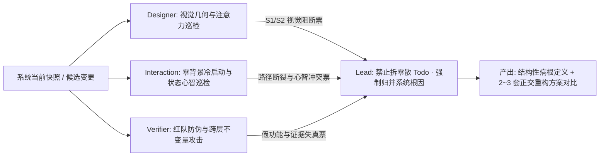

# Praxis 团队运行新契约：从被动执行到主动洞察与对抗式进化

> **状态**：生效中（严格遵守“不写代码、不盲目改任务”指令；仅产出团队运行新契约与自主盲审诊断）
> **关联文档**：[08-meta-reflection-and-team-operating-system.md](./08-meta-reflection-and-team-operating-system.md)
> **共同签署**：`lead` · `designer` · `interaction-architecture` · `verifier`

---

## 0. 病根解剖：为什么写完 849 行反思，团队依然陷在“被动等待输入”里？

上一轮的根本病灶不只是“Lead 独自写代码”，而是**把反思和验证都当成了静态交差**——你指一处，我们改一处；你不说话，我们就对着“99/99 测试通过 + 截图文件存在”默认万事大吉。

为了证明团队可以从此刻起彻底切断“等指令才看问题”的惯性，在本契约起草前，我立即唤醒 **`designer`（视觉美学与空间几何）**、**`interaction-architecture`（交互路径与状态心智）**、**`verifier`（红队防伪与跨层不变量）**，在不给任何修改暗示的前提下，对现有代码与你刚看到的截图做了一次**零外部输入交叉盲审**。

**不需要你指出“哪里不好用”，团队自主挖出了以下触目惊心的系统级裂缝：**

### 团队自主盲审挖出的真实裂缝清单（Factual Self-Audit）

| 视角 | 自主发现的结构性硬伤 | 源码与产物铁证 | 被动模式为何放过了它？ |
| :--- | :--- | :--- | :--- |
| **状态与领域因果** (`verifier` + `interaction`) | **Fork 污染导致因果倒挂**：截图中 `Intake` 为 `ACTIVE (1/11)`、`Question` 为 `PENDING`，下游 `Prereg Gate` 却是 `DONE`，甚至引擎 `gate(child, 'experiment')` 直接返回 `{allow: true}`！ | `set_knobs` 派生子 Run 时把 `state` 重置为 `INTAKE`，却原样继承了父 Run 的 `preregHash`；[`src/graph.js:308-316`](../../../plugins/dsh-praxis/src/graph.js#L308-L316) 只看 `preregHash` 不看拓扑前驱，把“历史哈希存在”渲染成“门已通过”。 | 单测用人工手写的 `fakeRun`，从未做过 `fork × graphView × gate` 跨模块不变量联测。 |
| **假工作流画布** (`interaction`) | **可编辑的图 + 不可编辑的线性游标**：允许用户连线、删点，但运行态完全按写死的 `STAGE_ORDER` 数组下标染色，**图的边根本不参与可执行性计算**；且 `Question` 节点没有任何推进命令（`start()` 直接跳去等 `prereg_freeze`），新用户点开第 1/2 步完全卡死。 | [`src/graph.js:294-343`](../../../plugins/dsh-praxis/src/graph.js#L294-L343) 中 `edges` 仅做原样透传；[`client.js:655`](../../../plugins/dsh-praxis/client.js#L655) 的 `MapCanvas` 甚至把所有认知地图节点硬编码为 `px-node ok`（未知/被反驳的主张全标成功色）。 | 只在乎“画布能拖、能画框”，把科学工具的真值纪律忘得一干二净。 |
| **空间与视觉失能** (`designer`) | **不存在任何一个“既看得全又读得清”的缩放档位**：主画布实宽 `840px`，15 节点一字排开宽 `3166px`。`90%` 下只露 4.4 个节点且上下 **85% 死白**；点 `适配` 缩到 `25%` 节点变成 `46×19px`（字号 `~3px`）且 `lod-far` 导致边端口错位；节点间距 `24px` 让贝塞尔曲线拧成反“S”麻花。 | [`src/graph.js:62-63`](../../../plugins/dsh-praxis/src/graph.js#L62-L63) 硬编码 `y=220, stepX=210`；[`client.js:162`](../../../plugins/dsh-praxis/client.js#L162) `dx=max(40, ...)` 控制点越界；`is-current` / `is-selected` / `hover` 共用 1px 黑框通道；22px 品牌头反压工作区。 | Lead 在 [`06-implementation-notes.md`](./06-implementation-notes.md) 单方面批准了 4 项偏离设计规格的妥协，Designer 无签字否决权。 |
| **交互心智混杂** (`interaction` + `designer`) | **假按钮与高危误触同栏裸奔**：顶栏黑色主按钮 `冻结契约` 点击后**并不提交命令**，只是偷偷改 `selectedId`；右侧 `320px` 窄栏把 8+ 个运行表单字段、`CONNECT` 拓扑编辑、红色 `删除节点` 挤成一列；在画布按退格键即刻无确认删节点写盘（删核心 Stage 必触发后端 `V5` 报错）；实验表单还暴露 `actor` 下拉框让前端伪造身份。 | [`client.js:715-723`](../../../plugins/dsh-praxis/client.js#L715-L723) `focusAction`；[`client.js:305`](../../../plugins/dsh-praxis/client.js#L305) `Backspace -> onDelete`；[`client.js:95-116`](../../../plugins/dsh-praxis/client.js#L95-L116) 未传 `expectedDomainVersion` 且 409 丢弃新 `view`；`App` 与 `Dock` 双重独立轮询。 | 没有区分“运行实验（Execution）”与“修改未来剧本（Blueprint）”，把底层 API 参数直接摊在界面上。 |
| **验收证据失真** (`verifier`) | **字节级重复截图与证伪的验收声明**：`dock-light.png` 与 `canvas-inspector-advanced-light.png` 的 SHA-256 完全一致（`2f14838e...`）；`dock-dark.png` 根本没有渲染出 Dock chip；`verification.md` 声称“连线 14→16 边”、“1024px 检查器下沉”，但对应截图明写 `边 14`，且 CSS 断点写成了 `1000px` 导致 1024px 下文字竖排崩坏；`client.js` (935行) 自动化测试覆盖率为 **0%**。 | [`docs/praxis/screenshots/`](./screenshots/) 哈希核验；[`client.js:916`](../../../plugins/dsh-praxis/client.js#L916) `@media (max-width: 1000px)` vs [`verification.md` line 105](../verification.md#L105)。 | 用“测试条数 + 截图张数”替代了可复现的真实任务门禁，发生了证据洗白（Evidence Laundering）。 |

---

## 1. 回答问题一：当没有外部输入时，团队如何自主扫描系统当前的结构性痛点？

**核心铁律**：废除“等用户报 Bug、等 Lead 派碎活”的被动待机。任何阶段（设计落盘、代码变更、候选交付前），无需外部输入，自动触发 **「三视角零输入巡检（Zero-Prompt Triad Sweep）」**。三个子代理带着**有罪推定**独立扫描、互不妥协：

### 1.1 `designer` 的常态化自主巡检标尺（审美与空间把关）
不看后端逻辑，只用硬性几何与视觉标尺审视真实渲染图（`1440×1000` 与 `1024×900`，明/暗双主题 + 10% 缩略模糊图 + 灰度图）：
- **1-3-10 秒冷读测试**：1 秒能否指出“当前节点”与**全屏唯一主动作**？3 秒能否看清完整路径形状与阻塞原因？若全屏同时存在 >1 个同级黑按钮，或品牌 Header 字号压过核心任务状态，直接判 **S1 阻断**。
- **全且清缩放律与占空比**：画布有效内容占比必须在 `55%–75%` 之间，顶部/外围 Chrome 高度占比 `≤ 15%`；必须存在一个默认视口，让全部核心节点在**不截断且正文字号 `≥ 11px`** 的前提下同时可读；边线严禁反“S”自交或端口吃箭头。
- **状态多通道可分性**：`当前执行（Current）`、`鼠标选中（Selected）`、`已完成（Done）`、`阻塞（Blocked）` 在去色灰度下必须靠**形态 + 位置标记**独立区分，严禁共用同宽黑框；严禁内部 ID（`gate:prereg`、`prereg_freeze`）裸露在主视觉层。

### 1.2 `interaction-architecture` 的常态化自主巡检标尺（可用性与心智模型把关）
把自己清空成**第一次打开页面的零背景研究者**，沿 3 条真实端到端主路径（① 立项→提问→冻结契约；② 遇 Gate 阻塞→补齐缺失→执行实验；③ 发现证据矛盾→更新认知地图→转向/收束）走查：
- **意图—动作唯一映射审计**：每个用户意图全屏只能有一个 canonical 提交面。凡出现“按钮文案叫执行动作，点完却只是悄悄移动焦点”、“一个节点亮着 Active 却没有任何方式推进到下一步”，直接判 **路径断裂**。
- **双轴状态自洽性审计**：严格区分 **执行游标（Execution: 未到达 / 当前 / 已通过）** 与 **凭证条件（Condition: 缺失 / 已满足 / 失效）**。凡把“有旧哈希”显示成“已走过此门”，或把认知地图里的 `unknown / contradicted` 节点染成绿色 `ok`，直接判 **心智欺骗**。
- **运行态与编排态硬隔离检查**：日常推进实验的界面上，严禁裸露无保护的 `Delete` 快捷键、拓扑删除按钮、伪造 `actor` 权限选择器；并发冲突（409）或断连时必须显式进入 `Stale / Needs Reconciliation` 保护态。

### 1.3 `verifier` 的常态化自主巡检标尺（红队破坏与防伪把关）
奉行 **“未经真实浏览器与跨层不变量证实的功能 = 假装能用”**：
- **证据法医鉴定（Artifact Forensics）**：对所有截图、日志校验生成脚本、SHA-256 去重、DOM 锚点存在性与源码 mtime 新鲜度。任何手工复制图片、声明与像素不符（如 1000px 断点冒充 1024px 适配），直接打回全部验收报告。
- **跨层状态模糊攻击（Cross-Layer Invariant Probing）**：不测模块自嗨的 `fakeRun`，专门用真实引擎跑 `start → prereg → set_knobs(fork) → graphView → gate` 等组合序列，用机器断言领域铁律（例：`gate === 'done' ⇒ guardedStage ∈ {'active', 'done'}`；拓扑边变更必须真实反映在可达性上）。
- **界面承诺全触发测试**：用自动化浏览器点击界面上每一个可见控件与键盘快捷键，凡触发后端 V1–V9 必败报错而前端无前置拦截、或保存后依赖 4 秒轮询才更新，一律开具 **P0 虚假功能票据**。

---

## 2. 回答问题二：面对模糊批评（如“不好用/视觉不行”）时，内部的排查与方案生成链路是什么？

当你说出“不好用”、“视觉不行”、“感觉很怪”这类定性判断时，背后的真实含义往往是**多个维度的结构性失调叠加成了糟糕的整体体感**。此时团队严禁做两件事：**第一，严禁反问你“具体改哪里”（把设计师和架构师的活推给你）；第二，严禁立刻下场改几行 CSS 碰运气。**

团队内部强制走完以下 **「四步闭环诊断与多方案对撞链路」** 后，才向你汇报：

1. **Step 1｜三视角盲扫定性（内部并发，不打扰用户）**
   - `designer` 查视觉重心、空间占空比、字阶呼吸感；
   - `interaction` 查第一眼认知锚点、点击推进链路、模式混杂度；
   - `verifier` 查底层数据状态是否本身就矛盾、交互是否有暗坑。
2. **Step 2｜症状向根因收敛（Symptom Clustering → Architectural Root）**
   - Lead 禁止把三方报告抄成 20 条零散 Todo；必须追问“**哪一个底层假设错了，才同时导致了这 10 个表面症状？**”
   - *实例*：连线拧麻花 + 85% 空白 + 缩放到 25% 看不清字 + 右侧被截断，表面是 4 个 UI 问题，底层其实是**同一个根因**——`buildDefaultGraph` 把 15 个节点排成了 `3166px` 的一维直线！改字号、调相机全是白费力气，改二维布局才是一剑封喉。
3. **Step 3｜先立“好标准”，再生成 2–3 套有真实张力的方案（Option Synthesis）**
   - 团队内部先写出可量化的“什么是好”（如：1 秒定位当前与唯一黑按钮、1160px 主区全路径 0 裁切且字号 ≥ 12px、运行态 0 拓扑破坏风险）。
   - 围绕不同设计哲学生成 **2–3 套真正不同且各有取舍（Trade-off）的完整方案**，内部先做红蓝对抗，淘汰掉违反硬约束的劣质解。
4. **Step 4｜带着“诊断结论 + 方案矩阵 + 明确推荐”与你对齐**
   - 每次呈交给你看的，必须是：**① 我们自己抓出来的根因；② 2–3 个成体系的解决路径及各自代价；③ 团队的首选推荐与理由**。你只需要做方向裁决，不需要替我们做排查和主笔设计。

---

## 3. 回答问题三：怎样确保是在做“全局最优的架构与体验设计”，而不是“单点疯狂内耗”？

为了从制度上杜绝“Lead 一个人埋头改 10 版 `client.js`、升 4 次版本号、陷入局部死胡同”，建立 **5 条刚性反内耗防线**：

1. **全局四层对齐门（先定骨架，再碰像素）**
   任何改动动工前，必须在一张图上同时对齐四件事：**领域真值层**（状态/Gate/Fork 因果律是否严密）→ **交互模态层**（运行推进与蓝图编辑是否解耦）→ **空间几何层**（全貌与焦点的视口比例是否成立）→ **自动化门禁层**（Playwright 任务测试与不变量断言是否已就位）。缺一层，不准写业务代码。
2. **局部修补「二次熔断律」（Two-Strike Escalation）**
   同一组件、同一视觉区域或同一交互逻辑，**连续调整 2 次仍未彻底解决或引发新别扭，强制停工熔断**。禁止第 3 次打补丁，必须回退到模型层或布局范式层重做方案。
3. **角色权责硬隔离与一票否决权（Separation of Powers & Hard Veto）**
   - **Lead 不自写核心 UI / 不自签验收**：Lead 负责问题收敛、契约协调与全局节奏；一旦 Lead 自己下场改实现文件超过 1 个模块，视为违约。
   - **Designer 握有视觉签字权**：任何偏离视觉规格（哪怕后端全绿），未经 Designer 审查明暗/宽窄视口截图并签字，不得合入或宣称完成。
   - **Verifier 握有发布阻断权**：写作用域与实现者物理隔离；凡无复现脚本的截图、覆盖率为 0 的前端改动、跨层不变量红灯，Verifier 直接挂 `BLOCKED`。
4. **以「垂直体验切片（Vertical Slice）」替代碎片化 Todo**
   任务板上严禁出现“调一下边距”、“加个字段映射”这类孤立工单。每个工作包必须是一个用户可感知的完整闭环（例如：“从新建 Run 到完成契约冻结的零断层体验闭环”）。
5. **用端到端客观门禁替代主观自我感觉**
   将 `test/praxis/` 明确拆分为 `contract/`（单元契约，必要非充分）与 `acceptance/`（真实服务 + 真实浏览器任务闭环 + 视觉包围盒与哈希防伪门禁），**只认 `acceptance/` 全绿作为“高可用”的唯一基准**。

---

## 4. 团队带着方案来探讨：解决当前全部结构裂缝的 3 套全局方案与 Trade-off

兑现上述契约——针对本次团队盲审抓出的 **“状态因果倒挂、单行 3166px 失能画布、运行态与改图态混杂、认知地图假绿”** 四大病根，团队内部已完成交叉对撞，形成 **底层必选地基 + 3 套空间与交互架构方案**：

### 地基共识（无论选哪套 UI 方案，底层必须同步修正的真值契约）
1. **双轴状态与 Fork 纯净性**：拆分节点的 `execution`（未到达 / 当前 / 已完成 / 阻塞）与 `condition`（契约缺失 / 已满足 / 继承待确认）；修复 `set_knobs` fork 时的状态对账，严禁 `INTAKE` 阶段出现 `Gate DONE` 倒挂；为 `Question` 明确阶段推进契约（或并入立项契约流）。
2. **执行态与蓝图编排态硬隔离**：默认进入只读、安全的 **运行态（Run Mode）**——彻底移除 `CONNECT`、`删除节点`、退格键删点、前端 `actor` 伪造下拉框；修改流程图必须显式进入 **蓝图草稿态（Blueprint Draft Mode）**，经 Schema 校验与 Diff 确认后生成新版本。
3. **单一真相与防伪门禁**：合并 `App` 与 `Dock` 为单一状态源，补齐 `expectedDomainVersion` 与 409 冲突恢复视图；恢复 `MapCanvas` 真实的 `unknown / contradicted / supported` 证据配色；建立 Playwright 真实浏览器门禁与截图 manifest 校验。

### 上层空间与交互架构的 3 套正交方案对比

| 维度 | 方案 A：全景折叠泳道画布 + 按需浮层工作区（团队首选推荐 ⭐） | 方案 B：阶段门栏分层 DAG（5 列语义阶段 × 贯穿式 Gate 门栏）+ 底部工作抽屉 | 方案 C：阶段时间线主控台主导 + 画布退居只读证据/拓扑副视图 |
| :--- | :--- | :--- | :--- |
| **空间与视觉结构** | • 砍掉臃肿的 84px 品牌大头，合并为 **60px 紧凑单顶栏**（全屏严格 **1 个黑色主动作按钮**）。 • 打破 `3166px` 单行直线，15 节点按研究阶段自动排成 **3 行语义泳道 / 蛇形折返**（总宽 `~910px × 316px`），在 `1160px` 主区 **100% 比例一屏全览、0 裁切、13px 字号清晰可读**。 • 右侧 Inspector 默认收起，点击节点或主动作时以 `360px` 浮层滑出，用 2px 强调色与对应节点视觉锚定。 | • 横向划分为 **5 个明确的研究阶段列**（立项 → 契约 → 讨论与实验 → 独立评估 → 记忆与决策），每列纵向排布阶段与并行分支节点。 • **3 道核心 Gate 画成贯穿整列高度的视觉“门栏线”**，直观表达“不过此门，右侧全列锁定”。 • Inspector 改为底部 `280px` 宽幅抽屉，彻底保住 `1160px` 完整横向视野。 | • 默认主屏采用**纵向阶段工作台 / 事件流（Tower Timeline）**，左侧是清晰的步骤轨，右侧 `75%` 宽幅区域直接展开当前阶段的完整表单、分歧对比与证据。 • 自由节点画布不再承担日常填表主入口，仅作为只读的“流程图 / 认知地图”切页与独立的“蓝图编辑器”存在。 |
| **核心优势** | **最平衡且最快达到上线品质**：既保留了直观的全局工作流画布心智，又一举消灭了“85% 空白、看不全、缩太小、麻花边”四大视觉顽疾；改造成本可控，明暗与窄屏自适应最稳。 | **科学治理与并行分支语义最强**：“贯穿式 Gate 门栏 + 阶段列”把 Praxis 的门禁契约与未来多 Persona 并行讨论的拓扑关系表达得最有张力，最具专业科研仪器感。 | **新用户零学习成本、复杂表单输入体验最好**：完全绕开二维画布的缩放、平移和空间排布复杂度，路径最短，最不容易出错。 |
| **代价与 Trade-off** | 折返行之间需要清晰的流向引导线与阶段分组底色；节点超过 30 个时需配合分组折叠。 | 需要实现真正的分层列式自动布局（Layered DAG Layout）与正交边路由，前端几何计算与窄屏（1024px）横滚降级成本最高。 | 放弃了“以工作流画布为核心主界面”的产品视觉特征，对多分支拓扑与全局因果关系的直觉呈现弱于 A 和 B。 |

---

## 5. 当前状态与待你拍板事项

- **代码与配置零改动**：遵循你的要求，本轮**未修改任何业务代码、测试或运行环境**，仅将这份共同签署的新契约落盘于 [`docs/praxis/redesign/09-proactive-team-charter.md`](./09-proactive-team-charter.md)。
- **下一步等待你的方向确认**：
  1. 这份《团队运行新契约》（三视角零输入盲审 + 四步模糊反馈诊断链 + 五条反局部内耗硬防线）是否符合你对主动型主管与高品味团队的标准？
  2. 在解决当前系统裂缝的架构方向上，你倾向于 **方案 A（全景泳道画布 + 浮层工作区）**、**方案 B（阶段列 + 贯穿门栏 DAG）**、还是 **方案 C（时间线主控台主导）**（或它们的特定组合）？一旦你定下方向，团队将严格按新契约分权推进。
