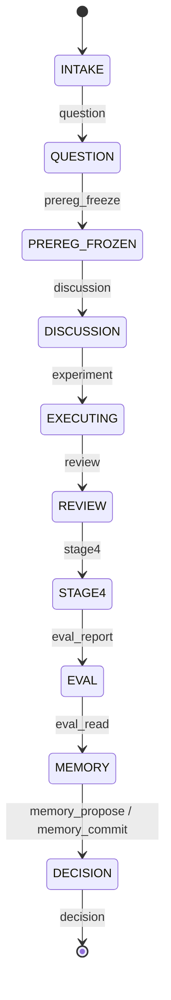
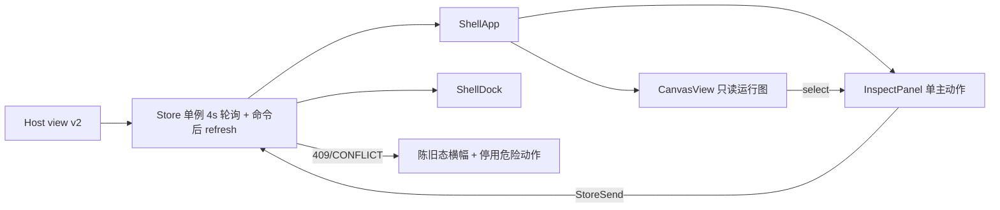

# Praxis v2 契约：真值模型、图、Wire、客户端模块与验收门禁

> **状态**：冻结（2026-11-05 00:55 北京时间）。实现必须符合本文件的编号条目；变更需新增 revision 并写明受影响条目。
> **上游**：[08 元反思](./08-meta-reflection-and-team-operating-system.md)、[09 团队运行契约](./09-proactive-team-charter.md)。
> **验收截止**：2026-11-05 10:30（北京时间）。

---

## 0. 完成定义（DoD）

| 编号 | 完成条件 | 证据 |
|---|---|---|
| D1 | `node --test test/praxis/**/*.test.js` 全绿，且测试数 ≥ 130 | 命令输出入库 |
| D2 | 真实浏览器验收测试全绿（`test/praxis/acceptance/browser.test.js`） | 测试输出 + manifest |
| D3 | 每张截图有 manifest 记录（sha256、构建 hash、端口、视口、主题、场景） | `docs/praxis/evidence/manifest.json` |
| D4 | 图状态审计 `audit.ok === true`，且对注入的损坏 dump 能报出违规 | 审计测试 |
| D5 | 客户端在 1440×1000 与 1024×900、亮/暗主题下 0 裁切、单主按钮、全流程一屏可见 | 截图 + 浏览器断言 |
| D6 | 运行态客户端不存在拓扑破坏控件；蓝图态修改必须 draft → diff → 确认 | 浏览器断言 + 代码审查 |
| D7 | README 与 `docs/praxis/verification.md` 记录真实的验证层级与未验证项 | 文档 |

---

## 1. 领域真值模型 v2

### 1.1 Run 状态机（唯一来源：`src/engine.js` 导出 `STATE_ORDER`）



`STATE_ORDER = ['INTAKE','QUESTION','PREREG_FROZEN','DISCUSSION','EXECUTING','REVIEW','STAGE4','EVAL','MEMORY','DECISION']`。

**T1.1**：新增动作 `question`。payload 形状：

```js
{ question: { text: string, hypothesis: string, unknowns: string[] } }
```

规则：`text` 与 `hypothesis` 非空（trim 后长度 ≥ 4），否则 `QUESTION_INCOMPLETE`，`nextAction: 'question'`。成功时写入 `run.question`、`advance(run,'QUESTION')`、`nextAction='prereg_freeze'`、`blockers=['prereg.frozen']`。

**T1.2**：`prereg_freeze` 在 `INTAKE` 状态被拒绝，`reasonCode: 'QUESTION_REQUIRED'`，`nextAction: 'question'`。在 `QUESTION` 及以后允许。

**T1.3**：非法状态转移一律拒绝，`reasonCode: 'INVALID_TRANSITION'`，不改 `state`、不改 `version`、append `transition.denied` 事件。

### 1.2 双轴节点状态（`src/graph.js` 导出 `graphStates`）

每个节点返回：

```js
NodeState = {
  execution: 'pending' | 'active' | 'done' | 'blocked' | 'failed',
  condition: 'missing' | 'satisfied' | 'stale' | 'unknown',
  reason: string | null,      // 人类可读原因，禁止内部码
}
```

| execution | 含义 | 判定 |
|---|---|---|
| `done` | 该节点已走过，且有 receipt | 见 T2.1 |
| `active` | 当前唯一前沿 | 拓扑可达且状态索引相等 |
| `blocked` | 到达但缺前置 | 前置未完成 |
| `pending` | 未到达 | 状态索引小于当前位置 |
| `failed` | 违规/漂移 | `DRIFT_DETECTED` 或审计失败 |

| condition | 含义 | 例子 |
|---|---|---|
| `missing` | 所需产物不存在 | gate 前无 prereg |
| `satisfied` | 产物存在且属于本 Run | 本 Run 冻结过 prereg |
| `stale` | 产物存在但来自父 Run / 旧版本 | fork 继承的 prereg |
| `unknown` | 无法判定 | 无数据 |

**T2.1 执行轴只由 receipt 与状态游标决定，不由产物存在决定。**
gate 的 `execution=done` 当且仅当：`index(STATE_ORDER[run.state]) >= index(guardedStageIndex)` 且该 gate 的通过动作已在本 Run 提交。禁止用 `run.preregHash` 单独推出 `done`。

**T2.2 拓扑钳制**：若任一前驱 `execution !== 'done'`，该节点 `execution` 不得为 `done` 或 `active`（`start` 除外）。

**T2.3 条件轴独立**：`condition` 只表达产物状态，不影响 `execution`。

**T2.4** `graphStates` 返回：

```js
{ states, current, edges, version, progress: { done:number, total:number, index:number }, audit: { ok:boolean, violations: Violation[] } }
```

`Violation = { code: 'I1'..'I6', nodeId?:string, message:string }`。

### 1.3 图不变量（I 系列）

| 码 | 不变量 | 违反后果 |
|---|---|---|
| I1 | `execution=done` 的节点，所有前驱必须 `done` | 审计失败，UI 显示 `NEEDS RECONCILIATION` |
| I2 | 同一连通分量内 `active` 节点 ≤ 1 | 审计失败 |
| I3 | gate `execution=done` ⇒ `condition !== 'missing'` | 审计失败 |
| I4 | gate `execution=done` ⇒ 被守护 stage `execution ∈ {active, done}` | 审计失败 |
| I5 | `progress.done` = `execution=done` 节点数；`progress.total` = 节点总数 | 不一致即失败 |
| I6 | 节点 `execution=done` ⇒ 其 stage 索引 ≤ 当前状态索引 | 审计失败 |

**T3.1**：`audit.ok === false` 时，`view.graph.audit.violations` 必须非空；Client 必须显示阻断横幅，且在该 Run 上禁止提交推进命令（只允许 `question`/`prereg_freeze` 修复类动作）。

### 1.4 Fork 纯净性

**T4.1**：`set_knobs` 派生子 Run 时：

- `state = 'INTAKE'`，`version = 0`，`parentId = 父 Run`；
- `preregHash = null`；
- `prereg.contract` 保留为草稿，`prereg.inheritedFrom = 父 Run.id`，`prereg.frozen = false`；
- 其余研究产物（claims、edges、personas、discussion、experiments、reviews、eval）保留，并标 `inherited: true`；
- append `run.forked` 事件含 `inheritedArtifacts: string[]`。

**T4.2**：fork 子 Run 未重新 `prereg_freeze` 前，`gate('experiment')` 必须 `allow=false, missing=['prereg.frozen']`。

**T4.3 迁移**：`load(dump)` 时，若某 Run 满足 `state === 'INTAKE' && preregHash != null`，执行 T4.1 的清理并 append `migration.reconciled` 事件，保留 `preregInheritedHash` 作审计。迁移幂等：重复 load 不重复 append。

---

## 2. 图契约 v2（`src/graph.js`）

### 2.1 布局

**T5.0**：节点 `label` 必须是人类可读中文（`开始 / 立项 / 研究问题 / 预注册门禁 / 预注册 / 讨论 / 执行门禁 / 实验 / 复核 / 阶段四 / 评估门禁 / 独立评估 / 记忆 / 决策 / 结束`）。客户端不得内置英文→中文映射作为主路径。

**T5.1**：布局是图的一部分。`buildDefaultGraph` 输出 `layoutVersion: 2` 与语义泳道坐标。

泳道定义（顺序固定）：

| lane | id | 标签 | 成员节点 |
|---|---|---|---|
| 0 | `define` | 定义问题 | `start`, `n_intake`, `n_question`, `g_prereg`, `n_prereg` |
| 1 | `explore` | 探索与执行 | `n_discussion`, `g_experiment`, `n_experiment`, `n_review`, `n_stage4` |
| 2 | `converge` | 证据与决策 | `g_eval`, `n_eval`, `n_memory`, `n_decision`, `end` |

合计 15 个节点（5/5/5）。每泳道宽 `5*156 + 4*28 = 892`。

几何常量（冻结）：节点 `w=156, h=64`；`gapX=28`；`laneStartX=24`；`laneStartY=40`；`laneGapY=120`。

`position = { x: laneStartX + i*(w+gapX), y: laneStartY + laneIndex*laneGapY }`。

**T5.2 迁移**：`load` 时，`graph.layoutVersion !== 2` 的图必须重算坐标，保留节点/边与手工新增节点（按拓扑序追加到所属泳道末尾）。

### 2.2 节点保护与端口规则

**T6.1 保护节点**：`start`、`end`，以及任何 `type ∈ {stage, gate}` 且 `stage`/`config.gate` 属于当前 playbook 的节点，`protected = true`。删除它们必须被拒绝：`PROTECTED_NODE`。

**T6.2 端口推导**：`derivePort(fromNode, toNode)`：
- `from.type === 'gate'` → `contract`（禁止 `artifact`，否则 `V9`）；
- `to.type === 'gate'` → `evidence`；
- 其余 → `artifact`。
Client 连线必须调用该规则，不得硬编码 `artifact`。

**T4.1a 继承字段唯一位置**：`run.prereg.inheritedFrom`（string|null）与 `run.prereg.inheritedHash`（string|null）；不要在 run 顶层再放同义字段。迁移事件 `migration.reconciled` 的 payload 带 `inheritedHash`。

**T8.6a** `GET /praxis/api/graph` 返回**扁平 graph 投影**（与 `view.graph` 同形，无 `{graph:...}` 包装）。

**T6.3 校验码**：保留 V1–V9；新增 `V10 PROTECTED_NODE`、`V11 INVALID_PORT_FOR_TYPE`。

### 2.3 引用

**T7.1**：`graphView(runId)` 返回 `{ graph, states, current, progress, audit, revision }`，其中 `graph.revision` 每次保存递增。

---

## 3. Wire 契约 v2（`src/http.js`、`src/host.js`）

**T8.1** `view.wireVersion = 2`。

**T8.2** `view.catalog`（唯一 UI 文案来源，客户端不得自建状态/动作中文映射）：

```js
catalog = {
  states: [{ id:'INTAKE', label:'立项', index:0 }, ...],
  nodeExecution: [{ id:'pending', label:'未到达', tone:'idle' }, ...],
  nodeCondition: [{ id:'missing', label:'缺失', tone:'warn' }, ...],
  actions: [{ id:'prereg_freeze', label:'冻结预注册', scope:'run', primary:true }, ...],
  reasons: { PREREG_INCOMPLETE:'预注册缺少必填项', ... },   // 原因码 → 人类可读
}
```

**T8.3** `view.graph` 形状：`{ id, playbookId, revision, layoutVersion, nodes, edges, states, current, progress, audit }`。

**T8.4** `GET /praxis/api/state` 返回 `{ ...view, view, serverTime, revision }`；`revision = active run version`。

**T8.5** `POST /praxis/api/command`：

- 请求：`{ command: { commandId, action, runId?, expectedDomainVersion?, payload? } }`；
- `expectedDomainVersion` 不匹配 → HTTP 409，`code:'CONFLICT'`，响应含当前 `view`；
- 其它拒绝 → HTTP 422，`code:<reasonCode>`，响应含 `receipt`、`view`、`nextAction`、`blockers`；
- 成功 → HTTP 200，`{ receipt, view }`。

**T8.6** `GET /praxis/api/graph?runId=` → 同 `view.graph`；`POST /praxis/api/graph` 保存必须带 `expectedRevision`，冲突返回 409 + 当前图。

**T8.7a 角色委托（delegated actor）**：`eval_report` 只允许 `evaluator`，`memory_propose` 只允许 `root`；UI 以 `user` 身份提交时必须显式携带 `payload.delegatedActor: 'evaluator' | 'root'`，Host 将其映射为 `{kind, id:'delegated:owner', delegatedBy:'owner'}` 并写入 `actor.delegated` 审计事件。未携带或值非法一律 422 `FORBIDDEN_ACTOR`。UI 必须在提交前用必选复选框取得用户明确同意（不可默认勾选）。

**T8.7** `GET /praxis/api/evidence` → `{ evidence: { runs:[{id,state,version,receipts,events}], audit } }`，供审计抽屉与浏览器测试断言。

---

## 4. 客户端模块契约

### 4.1 构建

源码按文件分模块，禁止直接手改 `client.js`：

```
plugins/dsh-praxis/client/00-primitives.js
plugins/dsh-praxis/client/10-store.js
plugins/dsh-praxis/client/20-layout.js
plugins/dsh-praxis/client/30-canvas.js
plugins/dsh-praxis/client/40-inspector.js
plugins/dsh-praxis/client/50-panels.js
plugins/dsh-praxis/client/60-shell.js
plugins/dsh-praxis/client/70-css.js
```

`node plugins/dsh-praxis/build-client.mjs` 按文件名排序拼接，包一层：

```js
window.__ModuleLoader__.load({
  id: '@local/dsh-praxis',
  factory(require) {
    const React = require('react');
    const h = React.createElement;
    const { useState, useEffect, useRef, useCallback, useMemo } = React;
    /* parts */
    return praxisPlugin();
  },
});
```

`node plugins/dsh-praxis/build-client.mjs --check` 只比对不写盘，不一致退出码 1（测试用）。

**B1**：所有 part 共享同一作用域，顶层标识符必须带模块前缀：`Prim*` / `Store*` / `Layout*` / `Canvas*` / `Inspect*` / `Panel*` / `Shell*`。禁止 `var`。

**B2**：`60-shell.js` 定义 `function praxisPlugin()`，返回 `{ inject:['slots'], apply(ctx){...} }`，注册三个 slot：`sidebar.panellist`、`main`（key `praxis`）、`conversation.composer.dock`。

### 4.2 模块导出（函数签名冻结）

| 模块 | 必须定义 |
|---|---|
| `00-primitives.js` | `PrimBtn`, `PrimField`, `PrimInput`, `PrimArea`, `PrimSelect`, `PrimChip`, `PrimBanner`, `PrimMenu`, `PrimShort(text,n)`, `PrimClock(iso)`, `PrimTabs` |
| `10-store.js` | `StoreCreate()` → 单例；`StoreUse()` → hook；`StoreApi(path,init)`；`StoreSend(action,payload,opts)`；字段 `{snapshot, phase:'loading'|'fresh'|'stale'|'error', error, updatedAt, revision}` |
| `20-layout.js` | `LayoutConstants`, `LayoutCompute(graph)`, `LayoutOrtho(a,b)`, `LayoutFit(graph,viewport)`, `LayoutCamera`(纯函数集) |
| `30-canvas.js` | `CanvasView(props)` |
| `40-inspector.js` | `InspectPanel(props)` |
| `50-panels.js` | `PanelSource`, `PanelRuns`, `PanelMap`, `PanelKnobs`, `PanelAudit`, `PanelEvidence` |
| `60-shell.js` | `ShellApp`, `ShellDock`, `ShellSidebar`, `praxisPlugin` |
| `70-css.js` | `const CssText = \`...\`` |

**B3**：`StoreCreate` 是模块级单例；`ShellApp` 与 `ShellDock` 必须共用同一实例（修复双轮询）。

**B4**：`ShellApp` 渲染 `<style>{CssText}</style>` 一次。

### 4.3 数据流



**B5**：`StoreSend` 必须携带 `expectedDomainVersion = snapshot.revision`，除非显式传 `{force:true}`。收到 409 时用响应里的 `view` 覆盖快照，并置 `phase='stale'`。

---

## 5. 视觉与交互规格 v3

### 5.1 结构（1440×1000）

| 区域 | 尺寸 | 规则 |
|---|---|---|
| 运行条 | 高 60px | 左：产品名 13px + Run 标题 + 状态 chip；中：双模态切换 `运行 / 蓝图`；右：**唯一主按钮** + `更多`菜单 |
| 引擎/阶段指示 | 运行条内 | 单行进度：`当前阶段 3/10` + 细进度条；禁止重复渲染 |
| 画布 | 剩余高度 | 3 条语义泳道；默认 `适配` 后 100% 显示全部 15 节点，字号 ≥ 11px |
| 检查器 | 宽 360px，浮层 | 默认收起；选中节点或点击主按钮时滑出；不占用画布宽度 |
| 抽屉 | 480px 浮层 | 源码 / 运行 / 地图 / 旋钮 / 审计 / 证据；同一时刻只开一个 |

### 5.2 节点解剖（156×64）

| 行 | 内容 | 字号 |
|---|---|---|
| 1 | 中文明标签 + 当前标记（左 3px 竖条 + 实心点 + `当前` 8px 角标） | 12.5px / 600 |
| 2 | 人类可读状态：`等待 / 进行中 / 已完成 / 被阻断 / 需核对` | 11px |
| 3 | gate 显示条件 chip：`契约已冻结 / 契约缺失 / 继承待确认`；stage 显示产物名 | 10px |

绝对禁止：内部码（`gate:prereg`、`prereg_freeze`、`close-or-new-run`）出现在节点正文。

### 5.3 状态视觉编码（去色可分）

| 状态 | 形状通道 | 颜色通道 | 灰度可分 |
|---|---|---|---|
| current | 左竖条 3px + 实心点 | brand | 是（形态） |
| selected | 外扩 3px 虚线环 | label-secondary | 是（dashed offset） |
| done | 实心填充图标 | success | 是（图标填充） |
| blocked | 斜纹底 + 三角图标 | warn | 是（斜纹） |
| failed | 双线边 + 叉图标 | error | 是（双线） |
| pending | 空心图标 | label-tertiary | 是（空心） |

### 5.4 模态分离

| 模态 | 允许 | 禁止 |
|---|---|---|
| 运行（默认） | 选节点、看状态、提交当前动作、看证据 | 拖节点、连线、删节点、改端口、改 actor |
| 蓝图 | 拖节点、连线（自动推导端口）、删除非保护节点、**保存前必须显示 diff 与校验结果** | 提交运行动作 |

**U1**：蓝图修改在保存前必须是本地草稿；未保存离开时必须提示。保存请求带 `expectedRevision`；冲突时展示冲突并保留草稿。

**U1a**：离开蓝图模态（含切换 Run、切回运行、关闭页面）时若存在未保存草稿，必须弹出确认；确认后丢弃草稿。

**U2**：`Delete`/`Backspace` 在运行模态无效；在蓝图模态只对选中且非保护节点生效，且需二次确认。

**U3**：全屏任意时刻只有一个 `primary` 按钮（`.px-btn-primary`）。

### 5.5 空态与异常态

| 场景 | 必须显示 |
|---|---|
| 无 Run | 单一入口卡：`新建研究运行` + 最近 3 个 Run；画布显示 3 条泳道骨架 + 引导文案 |
| 加载中 | 骨架屏，不显示旧数据为“当前” |
| 陈旧/冲突 | 顶部横幅：`数据已过期，已刷新到最新版本` + 停用推进按钮 |
| 审计失败 | 红色横幅：`状态不一致，需要核对` + 列出 violations（人类可读） |
| 服务不可达 | 错误态 + 重试按钮，保留最后成功时间 |

### 5.6 指标（浏览器测试断言）

| 指标 | 阈值 |
|---|---|
| 默认视口可见节点比例 | 15/15 = 100% |
| 内容包围盒宽度占画布宽度 | ≥ 70% |
| 内容包围盒高度占画布高度 | ≥ 20% |
| 主按钮数量 | = 1 |
| 节点正文内部码出现次数 | 0 |
| 运行模态破坏性控件数量 | 0 |
| 1024px 下横向溢出 | 0（允许画布内滚动，不允许页面横向滚动） |

### 5.7 Design Addendum（revision 1）

> 生效：2026-11-05 00:50（北京时间）。本小节是 §5 的可执行修订；与 §5.1–5.6 冲突时以本节为准，不改 §0–§4。测量根、夹具与断言代码见 `11-visual-acceptance-checklist.md`。
> 原则：设计否决只绑定可测判据；以下每个 D5 条目都必须能被浏览器测试或截图断言复现。

**D5-1 测量根与 1024 三种口径**

- 问题：§5.1/§5.6 的“1440/1024”未定义是浏览器视口还是 `.px-shell` 根。宿主侧栏占 280px，1024 全应用下 `.px-shell` 仅 744×840，canvas 744×840，world 892×304，fit=0.762；节点标题有效字号 9.5px。这是一种可观察的降级态，不是签收态。旧 D5-1 的 1076 宽是错误假设（把 lane1 当作 6 节点）；host v2 默认图是 **5/5/5、world bbox 892×304**。
- 修正（三种口径，必须写进 verifier 的 metrics）：
  1. **1440 签收**：全应用截图，`.px-shell` 1160×940（宿主侧栏 280）。应用 D5-3 字号、D5-2 面积。
  2. **1024 签收**：插件根 1024×840（宿主侧栏折叠或独立挂载），canvas 1024×840，fit=1.0。应用 D5-3 字号、D5-2 面积。
  3. **1024 全应用 compat**：`.px-shell` 744×840（canvas 744×840、fit=0.762）。只断言：页面/`.px-shell` 横向溢出 0；15/15 节点 rect 在 canvas 内；**“视口不足”提示可见**；画布可拖拽/缩放。**不套 D5-3 字号下限、不套 D5-2 面积**。这是兼容性证据，不是 1024 视觉签收；若宿主侧栏无法折叠，Lead 必须在门禁记录中写明“1024 signed 豁免，仅 compat”。
  4. **700×600**：canvas 700×540，natural fit=0.713<0.75；只断言 15/15 可见 + “视口不足”提示 + 可拖拽，不套面积/字号。
- **提示触发必须同时覆盖两种情况**：`raw fit < 0.75` **或 canvas 宽 < 900px**。只按 scale 触发时，1024 全应用 fit=0.762 恰好不触发，与上面第 3 条冲突；必须在 CanvasView 加 `canvasW < 900` 分支。
- 理由：不可复现的视口定义会让设计、实现、测试各说各话；1024 全应用是真实降级态，不能拿它冒充签收态，也不能把 0.762 的字体说成合规。

**D5-2 适配与内容占比（canonical 892×304）**

- 问题：§5.6“内容包围盒面积 ≥35%”与冻结几何不自洽。host v2 默认图 5/5/5：x=24+i×184，maxX=24+4×184+156=916，minX=24，故 **world bbox = 892×304**。1440 签收根 1160×940、fit 上限 1.0 时：W/W=892/1160=76.9%，H/H=304/940=32.3%，area=24.9%。1024 签收根 1024×840：W=87.1%，H=36.2%，area=31.5%。两种签收根都到不了 35%；在 1160 根下约需放大到 1.19 才到 35%。旧数字 1076×304 错误，按旧阈值 0.90/0.25 在 1440 下数学必红。
- 修正：`LayoutFit` 保持 `scale = clamp(min((W−64)/892, (H−64)/304), 0.75, 1.0)`；内容居中、四边 ≥24px；raw<0.75 进入视口不足降级。
  - 1440 签收根：**bboxW/W ≥0.75、bboxH/H ≥0.28、area ≥0.24**。
  - 1024 签收根：**bboxW/W ≥0.85、bboxH/H ≥0.28、area ≥0.28**。
  - 1024 全应用 compat / 700×600：不套面积，只套“100% 可见 + 提示 + 可拖拽”。
  - canonical 15 节点夹具按上述阈值；14 节点变体只断言 100% 可见。
- 理由：宽、高、面积分别约束“横向长蛇”“纵向真空”“整体空场”；数字来自 5/5/5 几何，可复算，verifier 不再必红。

**D5-3 字号下限（按有效字号；只约束签收根）**

- 问题：旧稿把 1024 签收根误算成 fit=0.892，据此要求 chip/角标 10.5；实际 1024 签收根 fit=1.0，正确问题是 **1024 全应用 compat fit=0.762**（标题 9.5、副行 8.4、chip 8.0），该状态已由 D5-1 归为 compat，不套字号。8px 文字角标已在 30-canvas 删除，改为 current 左轨+实心点+`aria-current`，正确。
- 修正：字号下限只适用于 **1440 签收根与 1024 签收根（fit=1.0）**：节点标题 ≥11.0；节点状态/副行 ≥9.5；条件 chip、泳道标签 ≥9.0；运行条标题 ≥12.0、状态/计数 ≥10.0；检查器正文 ≥11.5、字段标签 ≥10.0。当前值 12.5/11/10.5/11 均通过。若未来恢复文字角标，必须 ≥9.0 有效或纯装饰 `aria-hidden`。1024 全应用 compat 与 700×600 不套字号下限，但必须显示“视口不足”。
- 理由：字号是可复算指标；只对签收根设定下限，避免用不可能满足的阈值制造假红。

**D5-4 泳道视觉与动态节点数**

- 问题：§2.1 的三条泳道在 §5 中没有视觉定义；当前 CSS `.px-lane` 使用 `bg-layer-1` 55% 填充 + 1px 边框 + 10px 圆角，等于三个大卡片再装十五个小卡片，重回“卡片汤”。另外默认图可能为 14 节点（无 synthesis），不能把 15 写死。
- 修正：泳道是**纸面导轨**不是容器：不填充、无阴影、无圆角容器；仅用 1px 上/下水平细线 + 左对齐 11px 标签（定义问题/探索与执行/证据与决策）标记。泳道 y 与 laneGapY 保持 §2.1 冻结值；world bbox 与 fit 按实际节点数计算。全部测试同时跑 15 节点与 14 节点夹具。
- 理由：泳道承担“分组阅读”，容器填充会把注意力从节点状态转移到三个大框。

**D5-5 明暗主题对比度**

- 问题：§5 无任何对比度阈值；当前大量使用 `label-secondary`、`opacity:.55/.7/.8` 和状态色描边，浅色与深色下可能低于可读线。
- 修正：WCAG 2.1 AA，两个主题都必须过：正常文本（本 UI 全部 <18px）≥4.5:1；非文本指示（左轨、虚线环、状态图标、进度填充、focus ring）≥3:1；主按钮文字/底色 ≥4.5:1；状态 chip 文字/底色 ≥4.5:1。测试按 `getComputedStyle` 解析后的前景/背景色计算相对亮度，不使用设计稿 hex；`opacity` 合成后仍按最终像素判定。禁用态可豁免，但必须带 `aria-disabled`。
- 理由：对比度是可稳定测量的用户体验硬指标，不能靠“看起来还行”。

**D5-6 current / selected 去色可分**

- 问题：§5.3 声称可去色区分，但无几何断言；旧实现曾把 current、selected、hover、focus 全部做成同色 1px 边框。当前 CSS 已写入左轨 3px 与 dashed outline，但没有同时出现的测试。
- 修正：四态必须使用不同形状通道：`current` = 左 3px 实心竖条 + 6px 实心点；`selected` = 2px dashed 外框、offset 3px、无填充；`hover` = 仅 1px 实线边框；`focus-visible` = 2px 实线外框、offset 2px。测试场景必须同时存在 current 与 selected（选中另一个非 current 节点），在亮/暗主题注入 `filter: grayscale(1)` 后截图：两节点 8px 外扩裁切图的像素差 ≥0.8%，且 current 左轨在灰度下仍可检测（≥3px、与节点底色亮度差 ≥0.05）；同时断言 computed 形状属性。
- 理由：颜色是辅助通道，不是唯一通道；灰度截图能直接暴露“看起来一样”的退化。

**D5-7 主按钮唯一性、所有权与执行语义**

- 问题：§5.4 U3 要求任意时刻只有一个 primary，但未定义检查器打开、blocked、loading、empty 的矩阵；旧实现同时出现 3 个黑色按钮。当前 `ShellRunBar` 在检查器打开时用“收起面板”非动作按钮替换 primary，且 `blocked = blockers.length>0` 会把**由该动作解决的 blocker**（如 QUESTION 后的 `prereg.frozen`）也判为禁用，导致唯一动作不可执行。
- 修正：primary 数量矩阵：运行/阻塞/空态 = 1；加载/错误 = 0（错误态的“重试”算唯一 primary）；检查器内动作是 primary 时，运行条 primary 隐藏；检查器节点无动作时，运行条保留 primary；不得用非动作 ghost 顶替。抽屉或模态打开时，底层 primary 必须隐藏或 `inert`，顶层至多一个 primary。primary 点击必须二选一：无 payload 动作直接发命令并进入 busy；有 payload 动作打开检查器、聚焦第一个必填字段。只有审计失败/冲突/unknown 可禁用推进；由该动作解决的 blocker 必须保持可执行，并在按钮旁显示可见原因（不能只放 title）。primary 文本必须来自 `catalog.actions[].label`，禁止内部码。
- 理由：唯一主按钮是首屏定向的核心；禁用“解阻动作”会让用户无路可走。

**D5-8 内部码与目录文案**

- 问题：§5.2 只禁止节点正文内部码；检查器、运行条、空态仍可能漏出 `prereg_freeze`、`gate:prereg`、`PENDING`。当前 shell 有 `stateMeta?.label ?? active.state` 回退，catalog 缺失时会直接显示状态码。
- 修正：可见文本扫描范围 = `.px-runbar`、`.px-node`、`.px-empty*`、`.px-inspector`、`.px-run-item`，排除 `[data-technical]`、`code`、`pre`、`[data-raw="true"]`。禁止：snake_case 动作/原因码 `/[a-z]+(?:_[a-z]+)+/`、前缀码 `/\b(?:gate|stage|action|node)\s*[:：]\s*[a-z0-9_-]+/i`、状态机码 `INTAKE|QUESTION|PREREG_FROZEN|DISCUSSION|EXECUTING|REVIEW|STAGE4|EVAL|MEMORY|DECISION`、裸执行态 `pending|active|done|blocked|failed`。节点标题必须包含 CJK（来自 catalog/playbook 中文标签），primary 按钮文本禁止匹配 `^[a-z_]+$`。出现一次即失败。
- 理由：原始码让用户看到的是实现，不是研究状态。

**D5-9 1024 运行条与横向溢出**

- 问题：§5.1 的 60px 运行条包含产品名、Run 标题、状态 chip、双模态、进度、唯一 primary、更多；未给 1024 的收缩顺序。当前 CSS 只在 1180 缩进度条、900 才隐藏中心，1024 很可能溢出或互相覆盖。
- 修正：1024 根下 `.px-runbar` 的 `scrollWidth ≤ clientWidth`，所有子元素 rect 在运行条内且两两不相交；收缩优先级（从先到后）：产品 wordmark（保留 mark）→ 进度条轨道（保留 `n/N` 文本）→ Run 标题 max-width 160 → 灰色版本号；**状态 chip、primary、更多永不隐藏**。页面与 `.px-shell` 均无横向滚动；抽屉/检查器覆盖不撑宽。
- 理由：1024 是本轮 DoD 的窄屏边界；不允许用页面横向滚动掩盖布局失败。

**D5-10 空态 / 加载 / 陈旧 / 错误 / 审计的精确结构**

- 问题：§5.5 只写“单一入口卡 + 最近 3 Run + 3 条泳道骨架”，未定义按钮数量、重复入口和蓝图模式；当前 `60-shell.js` 空态只有标题、hint、一个按钮，没有最近 Run 与泳道骨架，且无图时仍可切到“蓝图”。
- 修正：`data-scene="empty"` 必须满足：唯一 primary = 1（`新建研究运行`，文案与 catalog 一致）；最近 Run 列表 ≤3 条且为次级行（非 primary、无删除）；画布同时渲染 3 条泳道骨架 + 标签 + 一句引导；`.px-node` 数量 = 0；运行条不渲染 primary，`更多` 菜单不得再出现“新建运行”；`蓝图` 模式禁用或隐藏。加载态：0 primary、骨架屏、不得把旧 snapshot 标成 current；错误态：1 primary（重试）+ 最后成功时间；陈旧/审计态：横幅 + 禁用推进但保留修复动作，见 D5-7。
- 理由：空态是唯一入口，重复入口会让新用户在两处之间犹豫。

**D5-11 测试钩子与场景**

- 问题：§5 没有给浏览器测试稳定的选择器；只用 class 断言会在样式重命名时碎裂，也无法读到缩放比例。
- 修正：必须提供：`.px-shell` 上 `data-testid="praxis-shell" data-scene data-theme`；`data-testid="runbar|canvas|world|inspector|empty|primary|banner|viewport-hint"`；`.px-canvas-world` 上 `data-scale`（如 `0.762`）；每个节点 `data-node-id data-execution data-condition data-current data-selected data-protected`；泳道 `data-lane`；primary 上 `data-action-id`。场景：running-1440、running-1024-signed、running-1024-compat、running-700、empty、loading、error、stale、audit-fail、selected、blocked、14-nodes，各跑亮/暗主题。CSS class 可变，data-* 是验收契约。
- 理由：没有可测钩子就没有可执行的设计否决权。

**D5-12 浮层、横幅与布局稳定**

- 问题：`px-shell` 的 grid 行是 `60 auto 1fr`，横幅出现会把画布推下；检查器在 ≤1180 变为底部 sheet，可能遮住选中节点；§5 未定义“不允许布局位移”。
- 修正：打开/关闭检查器、抽屉、横幅时，`.px-node` 的 getBoundingClientRect 变化 ≤1px；横幅使用固定 36px 槽或画布内 overlay，不得改变画布高度；检查器默认关闭，打开后选中节点矩形与检查器矩形不得相交（必要时相机平移）；≤1180 底部 sheet 最大高 46vh 且选中节点在剩余可视区内；Esc 关闭并归还焦点；检查器首屏可见字段 ≤5（必填组），其余进“高级”折叠，破坏性动作只在 `更多` 菜单并要求二次确认。
- 理由：画布位移会破坏空间记忆，是“回到已走过路径”的硬伤。

**D5-13 连线几何**

- 问题：§4.2 要求正交连线，但 §5 未给可见判据；旧实现出现过 28px 间隙下控制点反向造成的 S 卷、箭头被端口圆点遮住。
- 修正：同泳道相邻连线必须是水平单调路径（x 单调增、y 恒等；允许圆角），跨泳道为水平/垂直段 + ≤10px 圆角；路径长度 ≤1.15×Manhattan；路径不与任何 `.px-node` 矩形相交（端点外 4px 除外）；箭头终点在目标节点边界外 ≥4px，不被 10px 端口遮住；描边宽 1.2–1.6px，对比度 ≥3:1。测试对 SVG path 采样 20 点验证。
- 理由：这是上一轮最显眼的视觉瑕疵之一，且完全可以用几何断言锁死。

**5.7.1 替换后的 §5.6 指标（以此为准）**

| 指标 | 1440 签收（1160×940） | 1024 签收（1024×840） | 1024 全应用 compat（744×840） | 700×600 |
|---|---|---|---|---|
| 可见节点 | 15/15 | 15/15 | 15/15 | 15/15 |
| bbox 宽占比 | ≥0.75 | ≥0.85 | 不套 | 不套 |
| bbox 高占比 | ≥0.28 | ≥0.28 | 不套 | 不套 |
| bbox 面积占比 | ≥0.24 | ≥0.28 | 不套 | 不套 |
| 主按钮 | 1（按场景矩阵） | 1 | 1（compat 不测执行） | 1 |
| 内部码 | 0 | 0 | 0（文本可见域） | 0 |
| 页面/根横向溢出 | 0 | 0 | 0 | 0 |
| 字号下限 | 按 D5-3 | 按 D5-3 | 不套，仅提示 | 不套，仅提示 |
| 视口不足提示 | 不要求 | 不要求 | 必须出现（canvasW<900 触发） | 必须出现（raw<0.75） |
| 对比度 | ≥4.5 文本 / ≥3 非文本 | 同左 | 同左（可见文本） | 同左（可见文本） |
| 空态唯一入口 | 1 primary | 1 | — | — |
| 当前/选中灰度差 | ≥0.8% 裁切像素 | 同左 | 同左 | 同左 |

---

## 6. 验收门禁

| 门 | 位置 | 命令 |
|---|---|---|
| 契约/不变量 | `test/praxis/*.test.js` | `node --test test/praxis/*.test.js` |
| 构建一致性 | `test/praxis/client-build.test.js` | 含 `--check` |
| 浏览器验收 | `test/praxis/acceptance/browser.test.js` | `node --test test/praxis/acceptance/` |
| 证据 | `tools/evidence/capture.mjs` 生成 manifest | 见 D3 |

**A1**：浏览器测试使用独立 profile 与独立 `statePath`（`/tmp/praxis-acceptance/`），禁止写 `~/.dsh/praxis/state.json`。
**A2**：浏览器测试通过 CDP 驱动本机 Chrome，不引入新依赖。
**A3**：每条浏览器断言带场景名；失败输出实际值。

---

## 7. 写作用域

| 角色 | 文件 |
|---|---|
| host-core | `src/engine.js`, `src/graph.js` |
| lead | `src/host.js`, `src/http.js`, `index.js`, `build-client.mjs`, `client/00,10,60,70` |
| client-canvas | `client/20-layout.js`, `client/30-canvas.js` |
| client-panels | `client/40-inspector.js`, `client/50-panels.js` |
| verifier | `test/praxis/**`, `tools/evidence/**` |
| designer | `docs/praxis/**`, 只读源码 |

任何跨作用域修改先发给 Lead；Lead 负责合并与最终验证。
