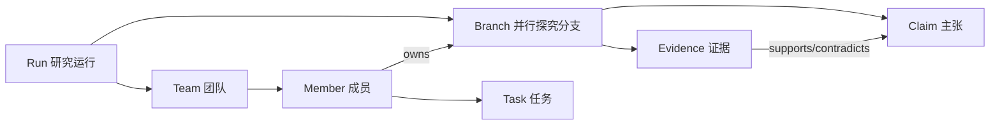

# Praxis v4 重写简报：Agent Team 研究驾驶舱

> 状态：冻结。2026-11-05 08:30。
> 上一版（v3）被判定"极差"。本文件说明改什么、为什么、验收标准。
> 期限：11:30（北京时间）。

---

## 1. 上一版为什么不合格

| 缺陷 | 事实 | 后果 |
|---|---|---|
| 团队不在产品里 | v3 的主视图是 15 个静态流程节点；界面里没有任何 agent、任务、会话、并行分支 | 用户看不到"谁在做研究"，产品的核心概念缺席 |
| 线性单轨模型 | 一条状态链走到黑；没有并行假设、没有分支合流、没有失败重来 | 真实研究无法表达；画布只能是流水线示意图 |
| 信息重心错位 | 画布占 60% 面积放 15 个 156×64 的盒子；证据、主张、分歧、预算全在右侧抽屉 | 一眼看到的不是研究，而是流程装饰 |
| 用代理指标当质量 | 优化了对比度、内容占比、测试条数、截图张数 | 可测量项达标，产品目标未达成 |

**v4 的判据**：研究者打开产品，3 秒内能回答：现在有谁在干什么、有哪些并行假设、哪条证据支持哪个主张、下一步必须由谁做。

---

## 2. 对象模型（v4）

### 2.1 四个一等对象



| 对象 | 定义 | 真相源 |
|---|---|---|
| `Run` | 一次研究运行，含预注册、阶段、决策 | Host 事件账本（已有） |
| `Branch` | 一条并行探究线：假设、负责人 agent、状态、证据集、结论 | **新增**：`run.branches[]`，事件驱动 |
| `Team` | 参与本 Run 的 agent 集合：Lead、teammates、subagents | **新增投影**：读 DSH `agentTeams` + `subagents` |
| `Evidence` | 可引用证据：实验产物、外部来源、复核结论 | `claims[].evidenceRefs` + artifacts |

### 2.2 Branch 状态机

```
proposed → active → (supported | refuted | inconclusive) → merged | dropped
```

- 同一 Run 允许多个 `active` 分支（这是与 v3 最重要的区别）。
- 每个分支必须有 `owner`（agent id）与 `falsifiable`（可证伪陈述）。
- 分支不能互相覆盖结论；矛盾保留，由合流动作处理。

### 2.3 分支事件（append-only）

```
branch.proposed  branch.assigned  branch.activated
branch.evidence  branch.verdict  branch.merged  branch.dropped
```

每个事件带 `branchId, actor, payloadHash, at`。

---

## 3. 团队投影（真实数据）

### 3.1 数据来源

| 来源 | 用途 |
|---|---|
| `ctx.agentTeams.listMembers(rootAgent)` | Lead + teammates：名字、状态、角色、任务 |
| `ctx.agentTeams.listTasks(rootAgent)` | 任务板：id、标题、状态、负责人、写作用域 |
| `ctx.subagents.listDescendants(rootSessionId)` | subagent 树：深度、状态 |
| `ctx.agents.roots()` | 找到当前 root agent |

### 3.2 降级

- 无 team 或服务不可用 → `view.team = { source: 'none', members: [] }`，界面显示"尚未组建团队"与组建入口。

### 3.3 视图形状

```js
TeamView = {
  source: 'live' | 'none',
  lead: { id, name, status } | null,
  members: [{ id, name, kind:'lead'|'teammate'|'subagent', status:'running'|'inactive'|'provisioning'|'failed',
              model, currentTask: { id, title, status } | null, branchIds: string[] }],
  tasks: [{ id, subject, status, ownerName, branchId }],
  counts: { running, idle, tasksOpen, tasksDone },
}
```

界面必须显示 `source`：`live` 时是真实团队，`none` 时不得伪装成有团队。

---

## 4. 界面（v4 驾驶舱）

### 4.1 布局（1440×1000）

```
┌──────────────────────────────────────────────────────────────────┐
│ 运行条 60px：Run 名 · 阶段 n/10 · 团队 3 人（2 运行中）· 唯一主动作 │
├───────────┬──────────────────────────────────────┬───────────────┤
│ 门禁轨    │ 分支板（主视图）                      │ 检查器 360px  │
│ 220px     │ 每分支一列：负责人 · 状态 · 证据数     │ 选中对象详情  │
│ 10 项     │ 并行排列，可横向滚动                   │ 动作/证据/结论│
│ 通过/阻塞 │                                      │               │
├───────────┴──────────────────────────────────────┴───────────────┤
│ 证据带 120px：主张 ← 证据引用，支持/反驳计数，矛盾保留             │
└──────────────────────────────────────────────────────────────────┘
```

### 4.2 主视图规则

| 区域 | 必须显示 | 禁止 |
|---|---|---|
| 运行条 | Run 名、阶段 `n/10`、**团队人数与运行中人数**、唯一主按钮 | 多个主按钮、内部码 |
| 门禁轨 | 每个 gate：名称、状态（已过/阻塞/未到）、缺失项 | 15 个等权节点铺满 |
| 分支板 | 每条分支：负责人（真人名或 agent 名 + 状态点）、可证伪陈述、证据数、结论 | 只画一个当前节点 |
| 证据带 | 主张、支持/反驳证据数、最新证据来源 | 把证据藏在抽屉 |
| 检查器 | 选中分支/成员/证据的详情与唯一动作 | 拓扑编辑控件出现在运行态 |

### 4.3 团队可见性

- 成员状态点：`running` 实心绿、`inactive` 空心、`provisioning` 脉冲、`failed` 红色。
- 每个分支标出负责人；负责人不在团队中时显示"未指派"并高亮。
- 点击成员 → 检查器显示该成员的当前任务、所属分支、最近产出。

---

## 5. 验收（v4）

| 编号 | 条件 | 证据 |
|---|---|---|
| A1 | `node --test test/praxis/*.test.js` 全绿，含新的 branch/team 契约测试 | 命令输出 |
| A2 | 真实浏览器：驾驶舱在 1440×1000 显示运行条 + 门禁轨 + ≥2 个并行分支 + 证据带 | 截图 + DOM 断言 |
| A3 | 团队投影：有真实 team 时 `source='live'` 且人数与 `listMembers` 一致；无 team 时 `source='none'` 且界面显示组建入口 | 单测 + 浏览器 |
| A4 | 并行：同一 Run 同时存在 ≥2 个 `active` 分支，界面同时显示，无"当前唯一"假设 | 单测 + 截图 |
| A5 | 证据带：主张与其证据引用可见，矛盾不被平均 | 单测 + 截图 |
| A6 | 运行态无拓扑编辑；蓝图/编辑能力移除或明确隔离 | 代码审查 + DOM 断言 |
| A7 | 三处证据（截图、manifest、测试输出）版本一致 | manifest buildHash |

---

## 6. 实施切分

| 角色 | 文件 | 交付 |
|---|---|---|
| Lead | `src/team.js`、`src/branch.js`、`src/host.js`、`src/http.js`、`client/60-shell.js`、`client/70-css.js`、`client/10-store.js` | 团队投影、分支模型、驾驶舱骨架 |
| branch-host | `src/graph.js` 仅保留 gate/审计；`src/engine.js` 分支事件 | 分支状态机与事件 |
| cockpit | `client/20-layout.js`、`client/30-canvas.js`、`client/40-inspector.js`、`client/50-panels.js` | 门禁轨、分支板、证据带、检查器 |
| verify | `test/praxis/**`、`tools/evidence/**` | 契约测试、浏览器验收、证据 |

写作用域互不重叠。Lead 负责构建、集成、验收。

---

## 7. 不做

- 不做 15 节点全流程画布。
- 不做拓扑连线编辑（v3 的蓝图态整体删除）。
- 不做 persona 表演；团队是真实 agent，不是角色扮演。
- 不用测试条数或截图张数替代 A2–A5 的任务断言。

---

## 8. 冻结的数据形状（客户端模块对接）

```js
BranchView = {
  id, title, hypothesis, falsifiable,
  ownerId: string|null, ownerName: string, ownerStatus: 'running'|'inactive'|'unknown',
  status: 'proposed'|'active'|'supported'|'refuted'|'inconclusive'|'merged'|'dropped',
  evidenceCount, supports, contradicts,
  verdict: string|null, taskId: string|null, updatedAt: string,
}

MemberView = {
  id, name, kind: 'lead'|'teammate'|'subagent',
  status: 'running'|'inactive'|'provisioning'|'failed'|'unknown',
  model: string|null,
  currentTask: { id, title, status }|null,
  branchIds: string[],
}

GatewayView = { id, label, status: 'passed'|'blocked'|'future', missing: string[], ownerRole: string }
EvidenceRow = { claimId, claim, status, supports, contradicts, latestSource, latestAt }
```

`view.branches[]`、`view.team`、`view.gates[]`、`view.evidenceRows[]` 由 Host 下发。客户端不推断团队状态。

## 9. 冻结的客户端模块 API

| 模块 | 导出 | props |
|---|---|---|
| `20-layout.js` | `LayoutConstants`, `LayoutBranchColumns(branches, viewport)`, `LayoutGateRows(gates)` | 纯函数，返回坐标 |
| `30-canvas.js` | `CanvasGateRail`, `CanvasBranchBoard`, `CanvasEvidenceBand` | 见 §10 |
| `40-inspector.js` | `InspectPanel` | `{ selection:{kind:'branch'|'member'|'evidence', id}, run, branch, member, evidenceRow, catalog, onAction, onClose }` |
| `50-panels.js` | `PanelRuns`, `PanelTeam`, `PanelEvidence`, `PanelAudit`, `PanelKnobs` | 各自抽屉 |

## 10. 组件 props（冻结）

```js
CanvasGateRail({ gates, currentStage, onSelect })
CanvasBranchBoard({ branches, members, selectedBranchId, onSelect, onOpenBranch, onCreateBranch })
CanvasEvidenceBand({ rows, selectedClaimId, onSelect })
```

主视图禁止出现：连线端口、节点拖拽、拓扑删除、`data-mode` 蓝图切换。
